<!-- Sinh tự động từ docs/architecture.json bởi factory-kit/scripts/factory-arch.mjs. Đừng sửa tay: sửa JSON rồi chạy lại script. -->
# Kiến trúc — Sổ Khách CRM

> Cập nhật: 2026-11-11 · commit `f6e63ed` · bản đồ tương tác: `docs/architecture.html`

CRM cho sale bất động sản: lưu khách, ghi chăm sóc khi mất mạng, đồng bộ giữa các máy và duyệt gợi ý AI trước khi áp dụng.

Stack: Vite + React 19 + TypeScript · Tailwind v4 + Radix + shadcn/ui · IndexedDB · Supabase · Cloudflare Pages + Workers · Capacitor Android

## Sơ đồ thành phần

```mermaid
flowchart TB
  subgraph L_delivery["Nơi mở ứng dụng"]
    n_pages["Web và bản dùng offline<br/>public/"]
    n_android["Vỏ Android<br/>android-app/"]
  end
  subgraph L_ui["Màn hình và thao tác"]
    n_app["Khung và điều hướng<br/>src/app/"]
    n_features["Các màn và hành động<br/>src/features/"]
    n_ui["Bộ giao diện dùng chung<br/>src/components/"]
  end
  subgraph L_logic["Luật dùng chung"]
    n_domain["Luật chăm sóc và tính toán<br/>src/domain/"]
    n_config["Số chuẩn và danh mục<br/>src/config/"]
  end
  subgraph L_local["Phiên và dữ liệu trên máy"]
    n_auth["Đăng nhập và phiên tài khoản<br/>src/data/"]
    n_repository["Cổng đọc và ghi dữ liệu<br/>src/data/repositories/"]
    n_local["Kho khách và hàng chờ<br/>src/data/"]
    n_sync["Đồng bộ và nhận cuộc gọi<br/>src/data/"]
  end
  subgraph L_cloud["Máy chủ và dịch vụ ngoài"]
    n_supabase["Supabase: dữ liệu và quyền<br/>SQL/"]
    n_worker["Cổng Worker<br/>worker/"]
    n_workers_ai["Cloudflare Workers AI<br/>Workers AI · binding AI"]
    n_gemini["Google Gemini: ảnh/giọng<br/>Google Gemini API"]
    n_meta["Meta Lead Ads<br/>Meta Graph API"]
  end
  n_pages -->|"khởi động bản web"| n_app
  n_app -.->|"đăng ký và cập nhật bản offline"| n_pages
  n_android -->|"nhờ web xử lý nút Back"| n_app
  n_app -.->|"mở bộ cài APK qua plugin"| n_android
  n_app -.->|"đọc manifest APK công khai"| n_supabase
  n_app -->|"gom route các màn"| n_features
  n_features -->|"dùng phiên và điều hướng chung"| n_app
  n_app -->|"dựng khung CRM"| n_ui
  n_app -->|"khởi tạo phiên tài khoản"| n_auth
  n_app -->|"nối phiên vào hooks"| n_repository
  n_app -->|"tạo client Supabase"| n_sync
  n_app -->|"mở kho riêng cho dữ liệu mẫu"| n_local
  n_features -->|"hiển thị component CRM"| n_ui
  n_features -->|"tính kế hoạch SLA"| n_domain
  n_features -->|"đọc cấu hình tín hiệu"| n_config
  n_features -->|"lưu ghi chú khách"| n_repository
  n_features -.->|"đăng nhập bằng email/mật khẩu"| n_auth
  n_features -->|"nối thao tác gọi và nhật ký"| n_sync
  n_features -.->|"đọc chi phí trực tiếp ngoài repository"| n_supabase
  n_features -.->|"gửi ngữ cảnh đã lọc tới /ai"| n_worker
  n_features -.->|"gửi ảnh đọc chữ tới /ocr"| n_worker
  n_features -.->|"gửi bản thu tới /stt"| n_worker
  n_features -.->|"chia sẻ tệp qua ShareFiles"| n_android
  n_ui -->|"đọc kết quả SLA để trình bày"| n_domain
  n_ui -->|"đọc số chuẩn SLA"| n_config
  n_domain -->|"dùng nguồn tín hiệu duy nhất"| n_config
  n_auth -->|"mở kho người dùng trước khi đọc mạng"| n_local
  n_auth -->|"khởi động đồng bộ của tài khoản"| n_sync
  n_auth -->|"tạo cổng khách cho phiên"| n_repository
  n_auth -.->|"kiểm email/mật khẩu qua Auth"| n_supabase
  n_repository -->|"hooks báo trạng thái đồng bộ lên khung"| n_app
  n_repository -->|"ghi khách và queue cùng giao dịch"| n_local
  n_repository -.->|"thử đẩy hàng chờ sau khi lưu"| n_sync
  n_repository -->|"kiểm trường được sửa ở khách nhóm"| n_domain
  n_repository -->|"dùng danh mục loại căn"| n_config
  n_repository -.->|"tải tệp hồ sơ vào Storage riêng tư"| n_supabase
  n_local -->|"giữ hợp đồng kiểu dữ liệu khách"| n_domain
  n_sync -->|"đọc và đẩy queue qua adapter"| n_local
  n_sync -->|"chuẩn hoá số để ghép cuộc gọi"| n_domain
  n_sync -->|"đưa cuộc gọi thiết bị vào cổng khách"| n_repository
  n_sync -.->|"ghi khách bằng phiên người dùng"| n_supabase
  n_sync -.->|"đăng ký nhận thay đổi Realtime"| n_supabase
  n_sync -.->|"đọc nhật ký gọi qua CallLog"| n_android
  n_worker -.->|"kiểm token qua Supabase Auth"| n_supabase
  n_worker -.->|"Meta đọc/ghi bằng service role"| n_supabase
  n_worker -.->|"nhờ model tạo đề xuất /ai"| n_workers_ai
  n_worker -.->|"đọc ảnh bằng Gemini"| n_gemini
  n_worker -.->|"chuyển giọng nói thành chữ"| n_gemini
  n_worker -.->|"kéo dữ liệu lead qua Graph API"| n_meta
  classDef cao stroke:#A32D2D,stroke-width:2px
  classDef vua stroke:#854F0B,stroke-width:1.5px
  class n_pages,n_android,n_app,n_features,n_domain,n_config,n_auth,n_repository,n_local,n_sync,n_supabase,n_worker,n_workers_ai,n_gemini,n_meta cao
```

Mũi tên `A --> B`: A gọi/dùng B, nên sửa B có thể ảnh hưởng A. Nét đứt: bất đồng bộ. Viền đỏ: rủi ro cao, viền nâu: rủi ro vừa.

## Khối

| Khối | Thư mục | Vai trò | Rủi ro | Lộ diện | Phụ thuộc vào | Sửa khối này ảnh hưởng tới |
|---|---|---|---|---|---|---|
| Web và bản dùng offline | `public/` | Cloudflare Pages phát bản web; bộ nhớ đệm giữ giao diện để mở lại khi mất mạng. | cao | Lộ ra Internet | Khung và điều hướng | Khung và điều hướng; Vỏ Android; Các màn và hành động; Cổng đọc và ghi dữ liệu; Đăng nhập và phiên tài khoản; Đồng bộ và nhận cuộc gọi |
| Vỏ Android | `android-app/` | Mở bản web production trong app Android, nối gọi điện, nhật ký gọi, giọng nói, chia sẻ tệp và cập nhật APK. | cao | Chỉ bên trong app | Khung và điều hướng | Khung và điều hướng; Các màn và hành động; Đồng bộ và nhận cuộc gọi; Đăng nhập và phiên tài khoản; Web và bản dùng offline; Cổng đọc và ghi dữ liệu |
| Khung và điều hướng | `src/app/` | Khởi động phiên, gom các màn, dựng thanh điều hướng, theme và thông báo cập nhật; mở phiên dữ liệu mẫu ở môi trường được phép. | cao | Lộ ra Internet | Web và bản dùng offline; Vỏ Android; Supabase: dữ liệu và quyền; Các màn và hành động; Bộ giao diện dùng chung; Đăng nhập và phiên tài khoản; Cổng đọc và ghi dữ liệu; Đồng bộ và nhận cuộc gọi; Kho khách và hàng chờ | Vỏ Android; Các màn và hành động; Web và bản dùng offline; Cổng đọc và ghi dữ liệu; Đăng nhập và phiên tài khoản; Đồng bộ và nhận cuộc gọi |
| Các màn và hành động | `src/features/` | Hôm nay, khách, hồ sơ, hẹn việc, giỏ hàng, vay, nhóm, báo cáo, cài đặt và các hộp Gọi/Zalo/Ghi chú/Hẹn. | cao | Lộ ra Internet | Khung và điều hướng; Bộ giao diện dùng chung; Luật chăm sóc và tính toán; Số chuẩn và danh mục; Cổng đọc và ghi dữ liệu; Đăng nhập và phiên tài khoản; Đồng bộ và nhận cuộc gọi; Supabase: dữ liệu và quyền; Cổng Worker; Cổng Worker; Cổng Worker; Vỏ Android | Khung và điều hướng; Vỏ Android; Web và bản dùng offline; Cổng đọc và ghi dữ liệu; Đăng nhập và phiên tài khoản; Đồng bộ và nhận cuộc gọi |
| Bộ giao diện dùng chung | `src/components/` | Cung cấp nút, form, bảng, khung CRM, tín hiệu và cách trình bày thống nhất cho các màn. | thấp | Chỉ bên trong app | Luật chăm sóc và tính toán; Số chuẩn và danh mục | Khung và điều hướng; Các màn và hành động; Vỏ Android; Web và bản dùng offline; Cổng đọc và ghi dữ liệu; Đăng nhập và phiên tài khoản; Đồng bộ và nhận cuộc gọi |
| Luật chăm sóc và tính toán | `src/domain/` | Tính thời hạn, follow-up, SLA, tín hiệu việc cần làm, tìm kiếm, chỉ số, ghép căn và vay; định nghĩa dữ liệu khách. | cao | Chỉ bên trong app | Số chuẩn và danh mục | Các màn và hành động; Kho khách và hàng chờ; Cổng đọc và ghi dữ liệu; Đồng bộ và nhận cuộc gọi; Bộ giao diện dùng chung; Khung và điều hướng; Đăng nhập và phiên tài khoản; Vỏ Android; Web và bản dùng offline |
| Số chuẩn và danh mục | `src/config/` | Giữ một nguồn của mã, nhãn, icon, khung giờ gọi, nhịp follow-up, SLA và thứ tự tín hiệu. | cao | Chỉ bên trong app | — | Luật chăm sóc và tính toán; Các màn và hành động; Cổng đọc và ghi dữ liệu; Bộ giao diện dùng chung; Khung và điều hướng; Đăng nhập và phiên tài khoản; Kho khách và hàng chờ; Đồng bộ và nhận cuộc gọi; Vỏ Android; Web và bản dùng offline |
| Đăng nhập và phiên tài khoản | `src/data/` | Đăng nhập Supabase, chọn đúng kho từng người và nối repository, đồng bộ cùng luồng nhận thay đổi. | cao | Lộ ra Internet | Kho khách và hàng chờ; Đồng bộ và nhận cuộc gọi; Cổng đọc và ghi dữ liệu; Supabase: dữ liệu và quyền | Khung và điều hướng; Các màn và hành động; Vỏ Android; Web và bản dùng offline; Cổng đọc và ghi dữ liệu; Đồng bộ và nhận cuộc gọi |
| Cổng đọc và ghi dữ liệu | `src/data/repositories/` | Cung cấp thao tác lưu khách và hooks cho màn; quản lý tài liệu, cài đặt, nhóm, giỏ hàng và bộ tài liệu gửi khách. | cao | Cần đăng nhập | Khung và điều hướng; Kho khách và hàng chờ; Đồng bộ và nhận cuộc gọi; Luật chăm sóc và tính toán; Số chuẩn và danh mục; Supabase: dữ liệu và quyền | Khung và điều hướng; Đăng nhập và phiên tài khoản; Các màn và hành động; Đồng bộ và nhận cuộc gọi; Vỏ Android; Web và bản dùng offline |
| Kho khách và hàng chờ | `src/data/` | Giữ khách và thao tác chưa đồng bộ trên thiết bị, tương thích dữ liệu và hàng đợi v1. | cao | Chỉ bên trong app | Luật chăm sóc và tính toán | Khung và điều hướng; Đăng nhập và phiên tài khoản; Cổng đọc và ghi dữ liệu; Đồng bộ và nhận cuộc gọi; Vỏ Android; Các màn và hành động; Web và bản dùng offline |
| Đồng bộ và nhận cuộc gọi | `src/data/` | Đẩy hàng chờ, kéo khách được phép xem, nhận Realtime và kiểm tra bù; nối nhật ký gọi Android vào repository. | cao | Cần đăng nhập | Kho khách và hàng chờ; Luật chăm sóc và tính toán; Cổng đọc và ghi dữ liệu; Supabase: dữ liệu và quyền; Supabase: dữ liệu và quyền; Vỏ Android | Khung và điều hướng; Đăng nhập và phiên tài khoản; Các màn và hành động; Cổng đọc và ghi dữ liệu; Vỏ Android; Web và bản dùng offline |
| Supabase: dữ liệu và quyền | `SQL/` | Giữ dữ liệu chung, đăng nhập, tệp và phát thay đổi; RLS, GRANT và trigger kiểm quyền tại máy chủ. | cao | Lộ ra Internet | — | Khung và điều hướng; Đăng nhập và phiên tài khoản; Các màn và hành động; Cổng đọc và ghi dữ liệu; Đồng bộ và nhận cuộc gọi; Cổng Worker; Vỏ Android; Web và bản dùng offline |
| Cổng Worker | `worker/` | Nhận yêu cầu AI, đọc ảnh, chuyển giọng nói thành chữ và nhận khách từ Meta; giữ khoá dịch vụ ở máy chủ. | cao | Lộ ra Internet | Supabase: dữ liệu và quyền; Supabase: dữ liệu và quyền; Cloudflare Workers AI; Google Gemini: ảnh/giọng; Google Gemini: ảnh/giọng; Meta Lead Ads | Các màn và hành động; Khung và điều hướng; Vỏ Android; Web và bản dùng offline; Cổng đọc và ghi dữ liệu; Đăng nhập và phiên tài khoản; Đồng bộ và nhận cuộc gọi |
| Cloudflare Workers AI | `Workers AI · binding AI` | Sinh tóm tắt, bản nháp Zalo, đề xuất từ ghi chú, tin retarget, gợi ý chăm sóc và lý do kết thúc cho route /ai. | cao | Cần đăng nhập | — | Cổng Worker; Các màn và hành động; Khung và điều hướng; Vỏ Android; Web và bản dùng offline; Cổng đọc và ghi dữ liệu; Đăng nhập và phiên tài khoản; Đồng bộ và nhận cuộc gọi |
| Google Gemini: ảnh/giọng | `Google Gemini API` | Đọc thông tin trên ảnh cho /ocr và chuyển bản thu âm tiếng Việt thành chữ cho /stt. | cao | Cần đăng nhập | — | Cổng Worker; Các màn và hành động; Khung và điều hướng; Vỏ Android; Web và bản dùng offline; Cổng đọc và ghi dữ liệu; Đăng nhập và phiên tài khoản; Đồng bộ và nhận cuộc gọi |
| Meta Lead Ads | `Meta Graph API` | Cung cấp người đăng ký từ quảng cáo Facebook/Instagram; báo sự kiện và cho Worker kéo bù thông tin lead. | cao | Lộ ra Internet | — | Cổng Worker; Các màn và hành động; Khung và điều hướng; Vỏ Android; Web và bản dùng offline; Cổng đọc và ghi dữ liệu; Đăng nhập và phiên tài khoản; Đồng bộ và nhận cuộc gọi |

## Chi tiết từng khối

### Web và bản dùng offline (`public/`)

- Dữ liệu sở hữu: Điểm khởi động src/main.tsx và index.html; cấu hình build vite.config.ts; public/_redirects, public/sw-cleanup.js; bản build trong dist/
- Quyền: Phát HTML, JavaScript, font và ảnh của app; Service Worker lưu giao diện và xoá cache giao diện v1 khi kích hoạt
- Giới hạn: Dữ liệu khách offline nằm ở IndexedDB, tách khỏi cache giao diện; Lần tải đầu và lấy bản cập nhật cần mạng; Cấu hình Pages thực tế nằm ngoài repo; chưa kiểm tra hosting bằng mạng
- Hợp đồng (không tự đổi): Build bằng Vite ra dist/; đường dẫn màn hình trả về index.html; Service Worker tên sw.js; báo Có bản mới để người dùng chọn tải lại
- Rủi ro bảo mật: Bản web cũ hoặc bị thay đổi ngoài ý muốn → Người dùng chạy giao diện lỗi, có thể ảnh hưởng dữ liệu và phiên đăng nhập. Chặn bằng: Asset được băm khi build; có thông báo cập nhật và dọn cache cũ. Quyền phát hành vẫn cần kiểm soát ngoài repo.
- Rủi ro bảo mật: Phát nhầm tài liệu nội bộ hoặc bản preview nối dữ liệu thật → Lộ bản đồ bảo mật hoặc sửa nhầm dữ liệu production. Chặn bằng: Build Vite chỉ lấy điểm vào và public/; docs/ không được khai báo sao chép vào dist/. Runbook yêu cầu Preview dùng staging; chưa xác minh cài đặt Pages đang chạy.
- Khi sửa: Cấu hình build và scripts là vùng cấm nếu task chưa mở rõ. Giữ dữ liệu IndexedDB khi dọn cache. Không phát bản đồ này công khai; không tự deploy production.

### Vỏ Android (`android-app/`)

- Dữ liệu sở hữu: capacitor.config.json và các plugin Java trong android/app/src/main/; Quyền điện thoại, micro, nhật ký gọi; tệp chia sẻ trong cache riêng
- Quyền: Xin người dùng cấp quyền gọi điện, đọc nhật ký và thu âm; Mở Zalo hoặc bảng chia sẻ; tải APK và mở hộp cài đặt Android
- Giới hạn: Quyền thiết bị có thể bị từ chối; web cần có phương án dự phòng; Vỏ mở bản web từ cấu hình server.url; cập nhật web và APK là hai việc riêng; Thiết bị cần cho phép cài đặt trước khi mở bộ cài APK
- Hợp đồng (không tự đổi): Capacitor.Plugins: CallLog, ExternalLink, AppInfo, AppUpdate, ClipboardImage, SpeechInput, ShareFiles; Giữ window.CRMBack(), sự kiện crm:resume và window.CRMCalls ở phía web
- Rủi ro bảo mật: Mã web bị chiếm quyền dùng cầu nối thiết bị → Lộ nhật ký gọi hoặc sử dụng micro, cuộc gọi và tệp chia sẻ. Chặn bằng: Vỏ dùng HTTPS, tắt mixed content; plugin xin quyền Android trước khi dùng chức năng nhạy cảm. Quyền web và quyền thiết bị vẫn cần bảo vệ cùng nhau.
- Rủi ro bảo mật: Tệp APK cập nhật bị thay đổi → Cài nhầm ứng dụng trên điện thoại. Chặn bằng: AppUpdate giới hạn địa chỉ tải; kiểm SHA-256 khi manifest có mã kiểm tra. Android vẫn yêu cầu quyền cài và mở hộp cài đặt.
- Khi sửa: android-app/** là vùng cấm nếu task chưa mở rõ. Giữ hợp đồng cầu nối ở §7 tài liệu viết tay và web dùng được khi thiếu plugin. Không tự build phát hành hay deploy.

### Khung và điều hướng (`src/app/`)

- Dữ liệu sở hữu: Router, layout, AppSessionProvider, theme và lệnh dùng chung; Nút Back Android; nhắc cập nhật web và APK
- Quyền: Khởi tạo Supabase client và RepositorySession; Phiên mẫu dùng kho riêng và chặn fetch ra ngoài; Đọc manifest APK công khai và gọi plugin cập nhật Android
- Giới hạn: Khung chỉ nối các phần; luật nghiệp vụ thuộc domain và config; Chế độ mẫu bị chặn trên production và trong vỏ Android; Một số màn tự vẽ khung bằng handle.bare để tránh lồng hai thanh điều hướng
- Hợp đồng (không tự đổi): Mỗi features/*/route.tsx xuất route: FeatureRoute; đường dẫn không trùng; Đổi tài khoản phải tháo phiên cũ trước khi nối kho mới
- Rủi ro bảo mật: Phiên cũ tiếp tục ghi sau khi đổi tài khoản → Trộn dữ liệu khách giữa các tài khoản. Chặn bằng: Session được dispose, hooks được tháo và kho cũ đóng; các tác vụ kiểm tra phiên còn hiện hành trước khi cập nhật.
- Rủi ro bảo mật: Phiên dữ liệu mẫu gửi yêu cầu ra dữ liệu thật → Thao tác thử ảnh hưởng khách thật. Chặn bằng: Demo dùng tài khoản và IndexedDB riêng, chặn fetch, dùng client giả và tắt đồng bộ mạng; chỉ mở ở môi trường được phép.
- Khi sửa: Giữ hợp đồng route, phiên và cầu nối Android. src/data/**, android-app/** và cấu hình build là vùng cấm nếu chưa được mở. Kiểm 360px, desktop, sáng/tối khi đổi khung.

### Các màn và hành động (`src/features/`)

- Dữ liệu sở hữu: Route, form và model riêng của từng tính năng; Hộp duyệt AI; lọc dữ liệu gửi /ai trong features/ai/privacy.ts; Bộ tài liệu gửi khách, nhập/xuất và form nhận gợi ý OCR
- Quyền: Đọc khách qua hooks; ghi chăm sóc qua CustomerRepository; Gọi Worker bằng phiên Supabase; người dùng chọn và duyệt trước khi lưu gợi ý AI; Hiện có lời gọi Supabase trực tiếp ở chi phí chiến dịch, báo giá vay và ghép chiến dịch với dự án
- Giới hạn: Gọi, Zalo và hẹn theo quyền phụ trách; sửa và ghi lịch sử khách nhóm theo D-025/D-032; AI cần mạng; đề xuất chưa duyệt không được ghi, gọi hay gửi tự động; Ảnh OCR và âm thanh STT được gửi sang Google; hai nhánh này chưa có bộ lọc SĐT trước khi gửi; Lời gọi Supabase trực tiếp là chỗ code lệch hợp đồng §0 về đi qua repository
- Hợp đồng (không tự đổi): openQuickAction(customerId, call | zalo | note | schedule | outcome); Dùng nhãn chung và các hàm thời hạn, SLA; không tự tạo luật mới; AI cập nhật qua hộp duyệt rồi repository; giữ nguồn field_meta.by = ai và next_tasks.source = ai
- Rủi ro bảo mật: AI hiểu sai ghi chú hoặc làm theo nội dung lạ trong dữ liệu khách → Đề xuất sai thông tin, việc hoặc lời nhắn. Chặn bằng: Ngữ cảnh /ai được chọn và lọc ở client, Worker lọc thêm và kiểm đầu ra; hộp duyệt kiểm lại dữ liệu hiện hành rồi mới ghi qua repository.
- Rủi ro bảo mật: Thông tin riêng trong ảnh hoặc âm thanh đi ra dịch vụ ngoài → Có thể gửi SĐT và thông tin khách cho Google. Chặn bằng: Chỉ gửi khi người dùng chọn ảnh hoặc thu âm; Worker yêu cầu phiên hợp lệ. Bộ lọc /ai không bảo vệ dữ liệu ảnh/âm thanh; cần Lead đối chiếu hàng rào không gửi SĐT cho AI.
- Khi sửa: Chỉ sửa feature được giao; giữ ít chạm, tiếng Việt có dấu, kiểm 360px và desktop sáng/tối. Không đổi domain/config, không vòng qua repository để thêm cách ghi mới. AI chỉ đề xuất, không gửi SĐT cho AI.

### Bộ giao diện dùng chung (`src/components/`)

- Dữ liệu sở hữu: src/components/ui và src/components/crm; src/lib/crm và src/lib/utils; src/lib/document-viewer; src/ui cũ còn dùng, gồm display.ts và CommandPalette
- Quyền: Hiển thị dữ liệu và phát sự kiện người dùng bấm; src/lib/crm đổi kết quả domain/config thành nhãn, mức tín hiệu và số đo để component dùng
- Giới hạn: Nhãn và màu dùng token, component và nguồn cấu hình chung; Phần ui cũ vẫn tồn tại trong lúc chuyển sang bộ component mới; Bộ giao diện không quyết định quyền ghi dữ liệu
- Hợp đồng (không tự đổi): Props component CRM và các hàm stageDef, slaFor, slaMeterFor, signalFor; displayText, displayDate, displayDateTime và nhãn hiển thị dùng chung
- Rủi ro bảo mật: Nội dung khách chèn mã vào giao diện → Chạy mã lạ trong phiên có dữ liệu và token. Chặn bằng: React hiển thị chuỗi có escape. Riêng phần tô từ tìm kiếm dùng HTML đã được highlight() ở domain/search escape trước khi bọc thẻ mark.
- Khi sửa: Theo docs/DESIGN.md và mẫu /dev/ui-kit. Dùng token cùng src/lib/crm, không tự chọn màu tín hiệu hoặc tính lại nghiệp vụ; giữ dấu tiếng Việt và kiểm màn 360px.

### Luật chăm sóc và tính toán (`src/domain/`)

- Dữ liệu sở hữu: Kiểu Customer, schema Zod giữ trường lạ, luật quyền sửa khách nhóm; Các hàm thời hạn, tín hiệu, kế hoạch tự chuyển SLA; ngữ cảnh cho AI
- Quyền: Nhận đầu vào rồi trả kết quả tính toán hoặc bản đề xuất thay đổi; Đọc số chuẩn từ src/config
- Giới hạn: Luật thuần không gọi mạng, IndexedDB hay React; Tự chuyển chỉ ở các bậc đã được cấu hình và duyệt; Thời hạn có giờ và hẹn gọi thêm 30 phút; việc cả ngày quá hạn từ ngày sau
- Hợp đồng (không tự đổi): Customer và schema .passthrough() giữ trường và JSONB lạ theo D-012; countdownTag, taskDueInfo, callReminder; status(customer, now); computeSignals(customers, ctx); TEAM_INFO_FIELDS, TEAM_LOG_FIELDS và isTeamWritePatch phải khớp trigger server
- Rủi ro bảo mật: Tính sai hạn hoặc quyền sửa khách nhóm → Bỏ sót chăm sóc, tự chuyển sai hoặc sửa quá quyền. Chặn bằng: Luật tập trung trong domain, dùng cùng cấu hình; có unit/golden test và trigger Supabase kiểm quyền thêm ở server.
- Rủi ro bảo mật: Mất trường chưa biết khi chuẩn hoá khách → Hỏng dữ liệu do bản app cũ và mới cùng dùng. Chặn bằng: Schema cho qua trường lạ; phép gộp và bản vá giữ thông tin ngoài trường đang sửa.
- Khi sửa: src/domain/** là vùng cấm đổi luật nếu task chưa mở rõ. Giữ D-010, D-012 và quyền D-025/D-032; dùng số chuẩn đã duyệt. Mâu thuẫn nghiệp vụ thì BLOCKED, không tự đặt luật để test xanh.

### Số chuẩn và danh mục (`src/config/`)

- Dữ liệu sở hữu: followup.ts, velocity.ts, signals.ts, icons.ts; Danh mục bậc, nguồn, kết quả gọi, lý do, loại việc, loại căn và các nhãn khác
- Quyền: Xuất hằng số và danh mục cho domain, dữ liệu và giao diện dùng chung
- Giới hạn: Mã đã lưu trong dữ liệu giữ nguyên nghĩa; Đổi số chuẩn có thể đổi hành vi toàn app; Tên biến môi trường được mô tả ở khối liên quan; khoá bí mật không đặt tại đây
- Hợp đồng (không tự đổi): D-005: followup; D-008: velocity; D-006: icons; D-015: signals; Chỉ thêm nhãn khi task cho phép; đổi quy tắc cần quyết định đã duyệt
- Rủi ro bảo mật: Đổi nghĩa mã hoặc ngưỡng mà các máy vẫn hiểu theo bản cũ → Phân loại khách và nhắc việc sai trên nhiều màn. Chặn bằng: Mã và số chuẩn tập trung một nơi; domain dùng lại và bộ test kiểm các trường hợp chuẩn. Hàng rào D-012 cấm đổi nghĩa mã đã lưu.
- Khi sửa: Không đổi nghĩa mã hoặc luật trong src/config/**. Chỉ thêm nhãn nếu task mở rõ; khung giờ, follow-up, SLA và icon phải sửa đúng nguồn duy nhất được chỉ định.

### Đăng nhập và phiên tài khoản (`src/data/`)

- Dữ liệu sở hữu: src/data/auth.ts; phần lắp ghép phiên trong src/data/repositories/session.ts; Thông tin người dùng gần nhất trong localStorage và vòng đời phiên
- Quyền: Gửi email/mật khẩu tới Supabase Auth qua SDK; Mở kho tài khoản đã nhớ khi offline; khi có mạng dùng phiên Supabase; Đóng kho, kênh Realtime và probe của phiên cũ khi đổi người hoặc đăng xuất
- Giới hạn: Đăng nhập mới cần mạng; chế độ offline chỉ dùng tài khoản đã nhớ; Đăng xuất đóng phiên local nhưng giữ kho IndexedDB của tài khoản; Nhớ tài khoản không phải mã hoá dữ liệu trên máy hay thay thế xác thực server
- Hợp đồng (không tự đổi): AccountAuth.boot, signIn, signOut và setAccount; RepositoryAccount gồm customers, remote, catalog, sync và sendKit tuỳ chọn; Báo kho local sẵn sàng trước khi chờ đọc mạng
- Rủi ro bảo mật: Token bị lấy hoặc phiên cũ trả kết quả muộn → Truy cập quá quyền hoặc trộn cache tài khoản. Chặn bằng: Supabase kiểm phiên ở server; RLS/GRANT giới hạn dữ liệu. Epoch và kiểm phiên hiện hành loại kết quả cũ; đóng DB và tháo kênh khi đổi tài khoản.
- Rủi ro bảo mật: Người khác dùng thiết bị có cache đã lưu → Lộ dữ liệu khách trên máy. Chặn bằng: Kho được tách theo tài khoản; đăng xuất bỏ người dùng nhớ và đóng kho đang mở. Code hiện không mã hoá IndexedDB, nên đây chỉ là cách ly phiên, không phải khoá thiết bị.
- Khi sửa: Auth trong src/data/** là vùng cấm và rủi ro cao. Task mở rõ phải giữ cách ly tài khoản, offline và xử lý kết quả muộn. Chỉ ghi tên biến môi trường, không đọc hoặc đưa token lên báo cáo.

### Cổng đọc và ghi dữ liệu (`src/data/repositories/`)

- Dữ liệu sở hữu: customers.ts, remote.ts, catalog.ts, sendKit.ts; hooks ở src/data/hooks/; Bộ gửi khách dùng IndexedDB crm_send_kit__<userId> riêng; giỏ hàng cache localStorage theo tài khoản
- Quyền: Ghi khách và thao tác chờ trong cùng một giao dịch IndexedDB; Người phụ trách ghi khách; người thấy khách nhóm vá phần được D-025/D-032 cho phép; Adapter remote gọi Supabase để tải tài liệu, cài đặt và nhóm; sendKit có đồng bộ riêng
- Giới hạn: Catalog lưu qua mạng; cache đọc không phải hàng đợi khách; Tài liệu hồ sơ, avatar và thao tác nhóm cần mạng; bộ gửi khách chỉ gửi offline được tệp đã có trên máy; sendKit giới hạn mỗi tệp 50 MB, nhận ảnh/PDF/video; Hooks hiện gọi setShellSync lên app: phụ thuộc thực tế khác sơ đồ một chiều ở §0
- Hợp đồng (không tự đổi): create, update theo trường, addNote, addTask, completeTask, logCall, assign, remove xoá mềm, restore; Giữ trường và JSONB lạ; không coi đọc lỗi là dữ liệu rỗng; Kho sendKit riêng giữ cờ chờ, xoá mềm và cách gộp dữ liệu khi tải lại
- Rủi ro bảo mật: Lưu khách thành công nhưng mất thao tác đồng bộ → Máy này thấy thay đổi nhưng máy khác không nhận được. Chặn bằng: customers.ts ghi bản khách và queue trong cùng transaction; giao dịch lỗi thì huỷ cả hai.
- Rủi ro bảo mật: Sửa khách nhóm ngoài phần được phép hoặc lấy nhầm tệp → Đổi hồ sơ quá quyền hoặc lộ tài liệu. Chặn bằng: Repository kiểm quyền và danh sách trường; Supabase RLS cùng trigger kiểm lại. Tài liệu riêng dùng URL có hạn; ảnh đại diện ở bucket public có giới hạn bảo mật khác.
- Khi sửa: src/data/** là vùng cấm nếu task chưa mở rõ. Giữ hợp đồng repository/hooks, patch theo trường, D-012 và quyền khách nhóm. Không áp hàng đợi khách sang catalog hoặc sendKit khi chưa có task riêng.

### Kho khách và hàng chờ (`src/data/`)

- Dữ liệu sở hữu: localdb.ts, queue.ts, legacyImport.ts, arrayMerge.ts; IndexedDB crm_khach_hang__<userId>, phiên bản 2: customers, queue, meta; Định dạng thao tác: opId, type, recordId, payload, ts; metadata gộp mảng và thao tác bị từ chối
- Quyền: Đọc/ghi IndexedDB theo tài khoản; đọc kho v1 để nhập một lần; Đẩy từng thao tác qua adapter được đồng bộ cung cấp; Gộp mảng lịch sử theo phần tử trước khi ghi có điều kiện lên server
- Giới hạn: Dung lượng do trình duyệt quyết định; xoá dữ liệu trình duyệt có thể mất phần chưa đồng bộ; Tách kho theo tài khoản, hiện không mã hoá dữ liệu tại chỗ; Thay toàn bộ cache chỉ khi queue rỗng và local không đổi trong lúc kéo
- Hợp đồng (không tự đổi): Giữ tên DB, version, store, keyPath và định dạng queue tương thích v1 theo D-012; Giữ trường và thuộc tính JSONB lạ; mảng dùng bản gốc để gộp ba chiều D-021; Lỗi đọc server không được biến thành tập rỗng rồi ghi đè local
- Rủi ro bảo mật: Kéo dữ liệu đè lên thay đổi offline hoặc làm mất lịch sử máy khác → Mất ghi chú, cuộc gọi và lịch hẹn. Chặn bằng: Kiểm revision và queue trước khi thay cache; gộp mảng ba chiều và ghi theo updated_at chưa đổi; dữ liệu đọc lỗi được giữ lại.
- Rủi ro bảo mật: Thao tác bị server từ chối làm tắc các khách khác → Chăm sóc trên máy không lên được mây. Chặn bằng: Queue phân biệt lỗi tạm thời và lỗi vĩnh viễn. Thao tác lỗi được hiện để người dùng xử lý; khi bỏ thao tác có lưu bản sao vào meta.
- Khi sửa: localdb, queue và arrayMerge trong src/data/** là vùng cấm. Task mở rõ phải giữ tương thích v1, D-012/D-021, patch và dữ liệu lạ; không xoá queue hay thay cache để che lỗi đọc.

### Đồng bộ và nhận cuộc gọi (`src/data/`)

- Dữ liệu sở hữu: sync.ts, realtime.ts, probe.ts, pagedFetch.ts, syncStatus.ts; supabase.ts: tạo client từ biến môi trường và adapter ghi khách; callSource.ts: đọc cuộc gọi thiết bị, chống trùng và nối thao tác gọi
- Quyền: Gọi Supabase bằng anon key công khai và phiên người dùng; Đọc queue, cập nhật cache theo kết quả server và báo trạng thái đồng bộ; Nhận nhật ký gọi qua plugin, chỉ ghép khách đang do tài khoản phụ trách
- Giới hạn: Mất mạng giữ thao tác lại; đồng bộ không thành công phải hiện lỗi; Probe chạy mỗi 15 giây khi kênh rớt, mỗi 60 giây khi kênh tốt; đồng thời thử đẩy queue mỗi 15 giây; Cột thường dùng dấu updated_at; mảng lịch sử được gộp theo D-021; Không đưa service-role key vào client; nhật ký gọi thiếu plugin dùng nhánh dự phòng
- Hợp đồng (không tự đổi): VITE_SUPABASE_URL, VITE_SUPABASE_ANON_KEY chỉ là cấu hình client; Realtime đăng ký postgres_changes bảng customers; mất sự kiện có probe kéo bù; window.CRMCalls; nhận crm:resume để kiểm cuộc gọi mới
- Rủi ro bảo mật: Sự kiện mạng đến muộn hoặc đọc lỗi bị coi là hết khách → Mất dữ liệu local hoặc dữ liệu sai tài khoản. Chặn bằng: Mỗi lượt kiểm phiên và kho còn mở; pull kiểm revision, queue và lỗi trước replaceAll. Realtime lỗi có trạng thái lỗi và probe kiểm bù.
- Rủi ro bảo mật: Ghi trùng hoặc ghép sai cuộc gọi thiết bị → Lịch sử chăm sóc và chỉ số bị sai. Chặn bằng: Chuẩn hoá số để ghép khách do mình phụ trách; kiểm device_id chống trùng, chỉ nhận chiều gọi và thời điểm hợp lệ.
- Khi sửa: Đồng bộ/auth trong src/data/** là vùng cấm, rủi ro cao. Task mở rõ phải kiểm offline, đổi tài khoản, hai máy và lỗi đọc; giữ D-012/D-021. Không sửa cầu nối Android ngoài hợp đồng được giao.

### Supabase: dữ liệu và quyền (`SQL/`)

- Dữ liệu sở hữu: customers cùng lịch sử JSONB, profiles, team_members, customer_changes; documents, user_settings, danh mục projects/buildings/units, bank_presets, loan_quotes, campaign_costs; fb_leads, fb_lead_queue, integration_health, lead_campaign_projects, send_kit_items; Storage: customer-docs và send-kit riêng tư; customer-avatars và app-releases công khai; Supabase Auth và Realtime
- Quyền: Frontend dùng phiên người dùng; RLS lọc theo chủ khách, nhóm và admin; GRANT cấp quyền thao tác; Worker Meta dùng SUPABASE_SERVICE_ROLE_KEY ở server để ghi hàng chờ, nhật ký và khách; Audit trigger ghi lịch sử thay đổi; client không có quyền sửa/xoá customer_changes
- Giới hạn: SQL/ chứa lịch sử migration, không phải một bộ cài mới đồng nhất; repo hiện không có thư mục supabase/; Đối chiếu file SQL không xác nhận policy, bucket hoặc GRANT đã chạy trên production/staging; Bucket ảnh đại diện và APK đọc công khai khi có đường dẫn; tài liệu riêng cần quyền và URL có hạn; Service role có quyền rộng, vượt lớp RLS của người dùng; chỉ giữ ở server
- Hợp đồng (không tự đổi): Migration mới chỉ thêm theo D-012; không chạy lại file lịch sử đổi/xoá dữ liệu; Giữ kiểu và nghĩa cột, JSONB lạ, RLS cùng GRANT; quyền nhóm khớp teamEdit.ts và trigger D-025/D-032; Khách xoá mềm; nhật ký audit chỉ thêm; dữ liệu client ghi theo trường
- Rủi ro bảo mật: Cấp quyền sai hoặc chỉ chặn bằng giao diện → Đọc hoặc sửa khách và tài liệu của người khác. Chặn bằng: SQL có RLS theo tài khoản/nhóm, GRANT và trigger guard_customer_assignment/guard_customer_team_edit; audit append-only. Cần kiểm môi trường thật trước khi kết luận các lớp này đã áp dụng.
- Rủi ro bảo mật: Lộ khoá đặc quyền hoặc dùng nhầm production khi thử → Đọc/ghi diện rộng trên dữ liệu thật. Chặn bằng: Client chỉ đọc VITE_SUPABASE_URL và VITE_SUPABASE_ANON_KEY; service role thuộc Worker. Preview được yêu cầu trỏ staging; giá trị cấu hình đang chạy chưa được kiểm.
- Rủi ro bảo mật: Nhầm ảnh công khai với tài liệu riêng tư → Ảnh khách có thể bị xem qua đường dẫn công khai. Chặn bằng: Tách customer-avatars public khỏi customer-docs private và send-kit private; tài liệu dùng đường dẫn ký có thời hạn. RLS không làm URL ảnh public thành riêng tư.
- Khi sửa: SQL/**, supabase/** và src/data/** là vùng cấm nếu task chưa mở rõ. Migration chỉ thêm D-012; giữ cả RLS và GRANT, backup trước thay đổi production. Chỉ ghi tên biến; không tự chạy SQL hay chạm secret.

### Cổng Worker (`worker/`)

- Dữ liệu sở hữu: intake-worker.js: /ocr, /ai, /stt; ai-assist.js, stt.js; fb-leads.js, meta/: /fb/*, hàng chờ bền vững, quét bù và tình trạng kết nối; wrangler.toml: binding AI, lịch chạy 5 phút và vị trí Worker
- Quyền: /ai, /ocr, /stt kiểm token qua Supabase Auth rồi gọi nhà cung cấp tương ứng; Nhánh AI chỉ trả đề xuất; nhánh Meta đọc/ghi Supabase bằng service role, tạo khách hoặc gắn lead qua RPC; Secret chỉ ở Worker: GEMINI_API_KEY, SUPABASE_SERVICE_ROLE_KEY, FB_APP_SECRET, FB_PAGE_ACCESS_TOKEN, FB_MANUAL_SECRET, FB_VERIFY_TOKEN
- Giới hạn: /ai tối đa 80.000 ký tự body, ngữ cảnh khách 40.000 ký tự, ghi chú 1.500 ký tự; kiểm đầu ra và thử tối đa 2 lần; /stt tối đa 8 MB, đúng loại audio, timeout 45 giây; /ocr timeout 45 giây/lần, tối đa 2 lần; Nhánh Meta tự giới hạn 45 lượt gọi mạng/lượt chạy, quét 48 giờ gần nhất; cron cấu hình mỗi 5 phút; ALLOWED_ORIGIN điều khiển CORS nhưng không thay xác thực; chưa thấy hạn mức /ai, /ocr, /stt theo từng người
- Hợp đồng (không tự đổi): VITE_WORKER_URL ở client; SUPABASE_URL, SUPABASE_ANON_KEY và ALLOWED_ORIGIN ở Worker; AI chỉ đề xuất: /ai, /ocr, /stt không tự ghi khách; Meta là nhánh nhập lead có ghi DB; Webhook Meta kiểm chữ ký trước khi nhận; ghi hàng chờ thành công mới xác nhận nhận lead
- Rủi ro bảo mật: Dùng cổng public để tiêu quota hoặc chi phí AI → Hết lượt dùng hoặc phát sinh chi phí dịch vụ. Chặn bằng: Ba route AI yêu cầu phiên Supabase hợp lệ; /ai giới hạn nội dung và đầu ra, /stt giới hạn byte/loại tệp, OCR/STT có timeout. CORS không chặn được mọi client; chưa có hạn mức theo người trong code.
- Rủi ro bảo mật: Giả sự kiện Meta hoặc ghi lead lặp → Khách rác, lịch sử trùng hoặc mất lead. Chặn bằng: Webhook kiểm HMAC từ FB_APP_SECRET; thao tác vận hành dùng FB_MANUAL_SECRET. lead_id chống trùng, hàng chờ thử lại, cron quét bù; khách có sẵn chỉ gắn lead qua RPC.
- Rủi ro bảo mật: Lộ khoá service role của nhánh Meta → Quyền đọc/ghi DB vượt RLS người dùng. Chặn bằng: Khoá chỉ dùng trong worker/meta/store.js và được khai báo là secret ngoài repo; client dùng anon key. Phạm vi quyền server vẫn rộng, cần bảo vệ cấu hình Worker.
- Khi sửa: worker/** là vùng cấm nếu task chưa mở rõ; không tự deploy hoặc đổi secret. Giữ AI chỉ đề xuất, không gửi SĐT cho AI; nhánh Meta cần hợp đồng bảo toàn D-012 và kiểm chống trùng.

### Cloudflare Workers AI (`Workers AI · binding AI`)

- Dữ liệu sở hữu: Dịch vụ khai báo ở worker/wrangler.toml [ai]; Qwen mặc định và GLM trong worker/ai-assist.js; lựa chọn model trong cài đặt AI
- Quyền: Nhận ngữ cảnh được client và Worker lọc, trả nội dung cho Worker kiểm tra; Dùng binding AI của tài khoản Cloudflare; không nhận khoá Supabase
- Giới hạn: Cần mạng và binding AI; có thể hết quota hoặc trả kết quả không hợp lệ; Không có quyền gọi repository, gửi Zalo hoặc đặt lịch; Che số trong văn bản dựa trên mẫu nhận diện, không phải bảo đảm ẩn mọi thông tin riêng
- Hợp đồng (không tự đổi): Các tác vụ brief, zalo, parse_note, retarget_msg, coach, close_reason trả JSON theo schema; Worker chọn trường an toàn, lọc số/email/mã định danh và kiểm kiểu đầu ra trước khi trả client
- Rủi ro bảo mật: AI bịa dữ kiện hoặc nghe theo chỉ dẫn trong ghi chú → Đề xuất sai hoặc nội dung không phù hợp. Chặn bằng: Prompt coi ghi chú là dữ liệu; lọc đầu vào, giới hạn token, kiểm JSON và schema ở Worker/client. Sale duyệt trước khi áp dụng; các lớp này không bảo đảm nội dung luôn đúng.
- Khi sửa: Chỉ chỉnh khi task mở worker/** hoặc tính năng AI liên quan. Giữ docs/prompts.md, không gửi SĐT, không tự ghi/gửi/gọi; mọi thay đổi qua hộp duyệt và repository.

### Google Gemini: ảnh/giọng (`Google Gemini API`)

- Dữ liệu sở hữu: Lời gọi Google trong worker/intake-worker.js và worker/stt.js; Model trong code: gemini-3.6-flash cho OCR; gemini-3.5-transcribe cho âm thanh
- Quyền: Nhận ảnh hoặc âm thanh mà người dùng gửi qua Worker; Worker xác thực với Google bằng GEMINI_API_KEY; dịch vụ không giữ quyền đọc DB CRM
- Giới hạn: Ảnh và audio gửi nguyên nội dung cần đọc; không áp bộ lọc văn bản /ai trước khi gửi; STT đặt store: false, trả tối đa 4.000 ký tự; Worker xử lý bản thu trong bộ nhớ; Nhận dạng có thể sai; OCR điền gợi ý vào form, người dùng kiểm rồi mới lưu
- Hợp đồng (không tự đổi): /ocr nhận image và mime, trả data; /stt nhận audio, trả transcript; Giới hạn 8 MB audio và timeout nằm ở Worker, không phải lời hứa của nhà cung cấp; Code hiện gửi ảnh/âm thanh có thể chứa SĐT; cần đối chiếu nguyên tắc không gửi SĐT cho AI, chưa coi là ngoại lệ đã được duyệt
- Rủi ro bảo mật: Dữ liệu nhận dạng chứa thông tin riêng hoặc nhận sai số điện thoại → Thông tin khách đi ra ngoài hoặc hồ sơ được điền sai. Chặn bằng: Người dùng chủ động chọn nội dung; Worker kiểm phiên, STT giới hạn dữ liệu và yêu cầu không lưu tương tác. OCR báo kiểm kỹ SĐT trước khi lưu; hiện chưa che SĐT trong ảnh/âm thanh trước khi gửi Google.
- Khi sửa: worker/** và secret là vùng cấm nếu task chưa mở rõ. Không mở rộng dữ liệu gửi ngoài; hàng rào AI không nhận SĐT vẫn phải được giữ. Bản đồ ghi thực trạng OCR/STT, không tự phê duyệt ngoại lệ.

### Meta Lead Ads (`Meta Graph API`)

- Dữ liệu sở hữu: Kết nối ngoài qua worker/meta/graph.js và worker/fb-leads.js; Cấu hình tên biến: FB_PAGE_ID, FB_PAGE_ACCESS_TOKEN, FB_GRAPH_VERSION, FB_APP_ID, FB_APP_SECRET, FB_LEAD_OWNER_ID
- Quyền: Meta gửi webhook tới Worker; Worker gọi Graph API bằng token trang; Worker gắn khách nhập vào người phụ trách cấu hình bởi FB_LEAD_OWNER_ID
- Giới hạn: Token và quyền của Meta có thể hết hạn hoặc thiếu; Thời gian nhận webhook không được bảo đảm; quét bù và hàng chờ nằm ở Worker; Khách nhập theo luồng Meta là automation nhập lead hiện có, tách với đề xuất AI
- Hợp đồng (không tự đổi): Webhook leadgen đi qua /fb/webhook; Graph API có phiên bản mặc định trong code; Trùng lead_id thì bỏ qua; trùng số thì RPC gắn tương tác lead_form, không ghi đè hồ sơ khách có sẵn
- Rủi ro bảo mật: Webhook giả, gửi lại hoặc token mất quyền → Khách rác, trùng khách hoặc ngừng nhận lead. Chặn bằng: Worker kiểm chữ ký và token xác minh webhook; lưu queue chống trùng lead_id trước khi xác nhận. Phân loại lỗi token/quyền, lưu integration_health và quét bù theo lịch.
- Khi sửa: worker/**, SQL/** và src/data/** là vùng cấm nếu task chưa mở rõ. Giữ chống trùng, hàng chờ và D-012; không gửi token lên báo cáo, không tự cấu hình Meta hoặc chạy SQL.

## Luồng dữ liệu

### Ghi chú khi mất mạng, máy khác nhận sau

1. **Các màn và hành động**: Sale mở Ghi chú, nhập nội dung rồi bấm lưu khi đang mất mạng.
2. **Cổng đọc và ghi dữ liệu**: addNote kiểm quyền và giữ các trường khác của khách.
3. **Kho khách và hàng chờ**: Một giao dịch lưu cả ghi chú vào khách và phiếu update vào queue; màn hình thấy thay đổi ngay.
4. **Đồng bộ và nhận cuộc gọi**: Khi có mạng, đồng bộ đọc phiếu chờ; phần chưa gửi vẫn được giữ lại nếu lỗi.
5. **Supabase: dữ liệu và quyền**: Mảng ghi chú được đọc/gộp trước khi ghi có điều kiện updated_at; RLS và trigger kiểm quyền, server lưu thay đổi.
6. **Đồng bộ và nhận cuộc gọi**: Trên máy thứ hai đã đăng nhập và có quyền xem khách, Realtime báo thay đổi rồi tải khách; probe kiểm bù nếu mất sự kiện.
7. **Kho khách và hàng chờ**: Máy thứ hai cập nhật kho của đúng tài khoản; không đè thay đổi còn chờ gửi của chính máy đó.
8. **Cổng đọc và ghi dữ liệu**: Repository làm mới bản khách và phát thông báo cho hooks.
9. **Các màn và hành động**: Màn đang mở trên máy thứ hai hiển thị ghi chú vừa nhận.

### Đăng nhập và mở đúng sổ khách

1. **Các màn và hành động**: Người dùng nhập email và mật khẩu trên màn đăng nhập rồi bấm vào app.
2. **Đăng nhập và phiên tài khoản**: AccountAuth gửi thông tin qua Supabase SDK; đăng nhập mới cần mạng.
3. **Supabase: dữ liệu và quyền**: Supabase Auth kiểm thông tin và trả phiên người dùng; quyền dữ liệu do RLS cùng GRANT áp dụng.
4. **Đăng nhập và phiên tài khoản**: Phiên cũ được đóng trước khi mở người mới; khi offline chỉ khôi phục tài khoản đã nhớ, không tạo phiên đăng nhập mới.
5. **Kho khách và hàng chờ**: Mở IndexedDB theo userId; dữ liệu trên máy được dùng trước khi chờ tải khách từ mạng.
6. **Đăng nhập và phiên tài khoản**: RepositorySession tạo bộ repository của tài khoản và nối kênh đồng bộ.
7. **Cổng đọc và ghi dữ liệu**: customers.refresh lấy khách trong kho local, hooks chỉ hiện dữ liệu của phiên hiện tại.
8. **Các màn và hành động**: Các màn hiện sổ khách đã có trên máy; dữ liệu mới được đồng bộ tiếp ở nền.

### AI đề xuất từ ghi chú, sale duyệt mới ghi

1. **Các màn và hành động**: Sale chọn nhờ AI tách thông tin và việc từ ghi chú; cần mạng, không xếp yêu cầu AI vào queue.
2. **Luật chăm sóc và tính toán**: buildAiContext chỉ lấy ngữ cảnh cần thiết, che SĐT/email/mã định danh trong văn bản; client lọc thêm các khoá riêng tư.
3. **Các màn và hành động**: requestAi gửi ngữ cảnh đã lọc và token đăng nhập tới /ai; nhánh này không gửi trường SĐT của khách.
4. **Cổng Worker**: Worker kiểm token qua Supabase Auth, lọc lại đầu vào và chọn tác vụ cùng model được phép.
5. **Cloudflare Workers AI**: Model tạo JSON đề xuất; không có quyền đọc DB CRM hay tự áp dụng thay đổi.
6. **Cổng Worker**: Worker kiểm cấu trúc và làm sạch kết quả trước khi trả app; kết quả không hợp lệ thì báo lỗi.
7. **Các màn và hành động**: Hộp duyệt cho sale chọn mục muốn áp dụng và kiểm lại khách hiện hành; chỉ sau khi bấm duyệt mới gửi bản vá.
8. **Cổng đọc và ghi dữ liệu**: Repository lưu bản vá đã duyệt, đánh dấu nguồn AI cho trường và việc tương ứng, giữ dữ liệu khác.
9. **Kho khách và hàng chờ**: Thay đổi đã duyệt được lưu local và vào queue; từ đây đi theo luồng đồng bộ khách thông thường.

## Bằng chứng mũi tên

| Từ | Tới | Loại | Nội dung | Bằng chứng |
|---|---|---|---|---|
| Web và bản dùng offline | Khung và điều hướng | call | khởi động bản web | `src/main.tsx:3` |
| Khung và điều hướng | Web và bản dùng offline | async | đăng ký và cập nhật bản offline | `src/app/UpdatePrompt.tsx:10` |
| Vỏ Android | Khung và điều hướng | call | nhờ web xử lý nút Back | `android-app/android/app/src/main/java/vn/sokhach/crm/MainActivity.java:28` |
| Khung và điều hướng | Vỏ Android | async | mở bộ cài APK qua plugin | `src/app/appUpdate.ts:369` |
| Khung và điều hướng | Supabase: dữ liệu và quyền | async | đọc manifest APK công khai | `src/app/appUpdate.ts:135` |
| Khung và điều hướng | Các màn và hành động | call | gom route các màn | `src/app/router.tsx:6` |
| Các màn và hành động | Khung và điều hướng | call | dùng phiên và điều hướng chung | `src/features/today/route.tsx:4` |
| Khung và điều hướng | Bộ giao diện dùng chung | call | dựng khung CRM | `src/app/layout.tsx:12` |
| Khung và điều hướng | Đăng nhập và phiên tài khoản | call | khởi tạo phiên tài khoản | `src/app/session.tsx:164` |
| Khung và điều hướng | Cổng đọc và ghi dữ liệu | call | nối phiên vào hooks | `src/app/session.tsx:175` |
| Khung và điều hướng | Đồng bộ và nhận cuộc gọi | call | tạo client Supabase | `src/app/session.tsx:10` |
| Khung và điều hướng | Kho khách và hàng chờ | data | mở kho riêng cho dữ liệu mẫu | `src/app/session.tsx:213` |
| Các màn và hành động | Bộ giao diện dùng chung | call | hiển thị component CRM | `src/features/today/route.tsx:5` |
| Các màn và hành động | Luật chăm sóc và tính toán | call | tính kế hoạch SLA | `src/features/today/route.tsx:15` |
| Các màn và hành động | Số chuẩn và danh mục | call | đọc cấu hình tín hiệu | `src/features/today/route.tsx:9` |
| Các màn và hành động | Cổng đọc và ghi dữ liệu | data | lưu ghi chú khách | `src/features/quick-actions/QuickActions.tsx:477` |
| Các màn và hành động | Đăng nhập và phiên tài khoản | async | đăng nhập bằng email/mật khẩu | `src/features/today/route.tsx:178` |
| Các màn và hành động | Đồng bộ và nhận cuộc gọi | call | nối thao tác gọi và nhật ký | `src/features/quick-actions/QuickActions.tsx:163` |
| Các màn và hành động | Supabase: dữ liệu và quyền | async | đọc chi phí trực tiếp ngoài repository | `src/features/settings/campaign-costs.tsx:64` |
| Các màn và hành động | Cổng Worker | async | gửi ngữ cảnh đã lọc tới /ai | `src/features/ai/model.ts:298` |
| Các màn và hành động | Cổng Worker | async | gửi ảnh đọc chữ tới /ocr | `src/features/intake/route.tsx:201` |
| Các màn và hành động | Cổng Worker | async | gửi bản thu tới /stt | `src/features/quick-actions/voice.tsx:121` |
| Các màn và hành động | Vỏ Android | async | chia sẻ tệp qua ShareFiles | `src/features/send-kit/nativeShare.ts:72` |
| Bộ giao diện dùng chung | Luật chăm sóc và tính toán | call | đọc kết quả SLA để trình bày | `src/lib/crm/stages.ts:18` |
| Bộ giao diện dùng chung | Số chuẩn và danh mục | call | đọc số chuẩn SLA | `src/lib/crm/stages.ts:16` |
| Luật chăm sóc và tính toán | Số chuẩn và danh mục | call | dùng nguồn tín hiệu duy nhất | `src/domain/signals/index.ts:2` |
| Đăng nhập và phiên tài khoản | Kho khách và hàng chờ | data | mở kho người dùng trước khi đọc mạng | `src/data/auth.ts:62` |
| Đăng nhập và phiên tài khoản | Đồng bộ và nhận cuộc gọi | call | khởi động đồng bộ của tài khoản | `src/data/auth.ts:68` |
| Đăng nhập và phiên tài khoản | Cổng đọc và ghi dữ liệu | call | tạo cổng khách cho phiên | `src/data/repositories/session.ts:35` |
| Đăng nhập và phiên tài khoản | Supabase: dữ liệu và quyền | async | kiểm email/mật khẩu qua Auth | `src/data/auth.ts:118` |
| Cổng đọc và ghi dữ liệu | Khung và điều hướng | call | hooks báo trạng thái đồng bộ lên khung | `src/data/hooks/index.ts:46` |
| Cổng đọc và ghi dữ liệu | Kho khách và hàng chờ | data | ghi khách và queue cùng giao dịch | `src/data/repositories/customers.ts:60` |
| Cổng đọc và ghi dữ liệu | Đồng bộ và nhận cuộc gọi | async | thử đẩy hàng chờ sau khi lưu | `src/data/repositories/customers.ts:102` |
| Cổng đọc và ghi dữ liệu | Luật chăm sóc và tính toán | call | kiểm trường được sửa ở khách nhóm | `src/data/repositories/customers.ts:6` |
| Cổng đọc và ghi dữ liệu | Số chuẩn và danh mục | call | dùng danh mục loại căn | `src/data/repositories/catalog.ts:3` |
| Cổng đọc và ghi dữ liệu | Supabase: dữ liệu và quyền | async | tải tệp hồ sơ vào Storage riêng tư | `src/data/repositories/remote.ts:42` |
| Kho khách và hàng chờ | Luật chăm sóc và tính toán | call | giữ hợp đồng kiểu dữ liệu khách | `src/data/localdb.ts:9` |
| Đồng bộ và nhận cuộc gọi | Kho khách và hàng chờ | data | đọc và đẩy queue qua adapter | `src/data/sync.ts:36` |
| Đồng bộ và nhận cuộc gọi | Luật chăm sóc và tính toán | call | chuẩn hoá số để ghép cuộc gọi | `src/data/callSource.ts:3` |
| Đồng bộ và nhận cuộc gọi | Cổng đọc và ghi dữ liệu | data | đưa cuộc gọi thiết bị vào cổng khách | `src/data/callSource.ts:98` |
| Đồng bộ và nhận cuộc gọi | Supabase: dữ liệu và quyền | async | ghi khách bằng phiên người dùng | `src/data/supabase.ts:51` |
| Đồng bộ và nhận cuộc gọi | Supabase: dữ liệu và quyền | async | đăng ký nhận thay đổi Realtime | `src/data/realtime.ts:32` |
| Đồng bộ và nhận cuộc gọi | Vỏ Android | async | đọc nhật ký gọi qua CallLog | `src/data/callSource.ts:63` |
| Cổng Worker | Supabase: dữ liệu và quyền | async | kiểm token qua Supabase Auth | `worker/intake-worker.js:211` |
| Cổng Worker | Supabase: dữ liệu và quyền | async | Meta đọc/ghi bằng service role | `worker/meta/store.js:36` |
| Cổng Worker | Cloudflare Workers AI | async | nhờ model tạo đề xuất /ai | `worker/ai-assist.js:305` |
| Cổng Worker | Google Gemini: ảnh/giọng | async | đọc ảnh bằng Gemini | `worker/intake-worker.js:239` |
| Cổng Worker | Google Gemini: ảnh/giọng | async | chuyển giọng nói thành chữ | `worker/stt.js:21` |
| Cổng Worker | Meta Lead Ads | async | kéo dữ liệu lead qua Graph API | `worker/meta/graph.js:45` |
