# Tasks — Kế hoạch đại tu Sổ Khách v2

> **Version:** 1.0 · 2026-10-16. Phạm vi: `PRD.md`. Kỹ thuật: `architecture.md`. Quyết định: D-011…D-015.
> **Cách dùng:** chọn task có trạng thái ☐ mà mọi phụ thuộc đã ☑ → mở phiên agent với prompt `prompts.md` B.1. Task cùng **sóng** và cùng **nhóm song song** chạy cùng lúc được (mỗi phiên 1 worktree/bản clone + 1 nhánh `task/…`; tự merge qua cổng — §0 luật 7).

## 0. Luật làm task (cho agent)

1. **Nhánh:** Phase 0 làm trên `main` (không đổi runtime v1 trừ T0.2 SQL). Từ T1.1: nhánh tích hợp `v2`; mỗi task một nhánh **`task/<T-ID>-<slug>`** tách từ `origin/v2` (không dùng `v2/…`: Git cấm vì đã có nhánh `v2`). Không đụng `main` khi chưa tới T5.4.
2. **Sở hữu file:** chỉ sửa file/thư mục trong mục *Sở hữu* — bản máy đọc được ở `scripts/agents/ownership.json` (cổng merge chặn mọi file ngoài danh sách). Cần thêm/sửa file ngoài phạm vi (kể cả file mới trong `src/config/`, `src/ui/`) hoặc đổi API của task khác → dừng, báo người điều phối thêm vào `ownership.json` trước. **Không thêm thư viện** ngoài bộ T1.1 đã cài (CLAUDE.md §3.10).
3. **Tự đăng ký:** route (`src/features/*/route.tsx`), tín hiệu (`src/domain/signals/rules/*.ts`), lệnh (`src/features/*/commands.ts`) — không sửa file router/registry chung.
4. **Dữ liệu:** mọi task chạm `src/data`, `SQL/`, schema, repository phải tự rà checklist `prompts.md` B.3 trên diff của mình trước khi gọi cổng merge (có vi phạm → không gọi cổng, báo lại). Agent **không bao giờ** chạy SQL trên Supabase. Migration production chỉ do **chủ dự án** chạy sau khi đã backup (T0.1) và chạy thử trên staging.
5. **Xong khi** = mọi tiêu chí trong thẻ + cổng merge chạy thành công (cổng tự chạy `npm run check` + `build` + golden, tự ghi ☑ vào bảng §2 và mục `CHANGELOG.md` — agent **không** tự sửa 2 file này).
6. **Cỡ:** S ≈ ½ phiên · M ≈ 1 phiên · L ≈ 2–3 phiên (chia nhỏ nếu cần, giữ ID con `T3.5a`…; ID con phải có mục riêng trong `ownership.json`).
7. **Tự merge (chủ dự án duyệt 2026-10-16):** xong việc → commit trên `task/<T-ID>-<slug>` → viết tóm tắt vào 1 file (dòng 1 = tiêu đề, sau đó gạch đầu dòng đã đổi/đã kiểm tra) → chạy `node scripts/agents/merge-to-v2.mjs <T-ID> --changelog <file>` (thêm `--e2e` nếu đổi luồng UI). Cổng: lấy `v2` mới nhất + rebase → kiểm phụ thuộc ☑ → kiểm phạm vi file + luật dữ liệu (không đụng `legacy/` trừ T1.1 chuyển nguyên vẹn, không sửa migration cũ, SQL mới không drop/rename/đổi kiểu/xoá dữ liệu, không lộ khoá) → test → ghi ☑ + CHANGELOG → push fast-forward lên `v2` (không force; bị chen → tự làm lại). Thoát khác 0 = **chưa merge**: đọc lý do; xung đột với task khác → dừng và báo, không tự sửa file của task khác. Không mở PR, không merge tay.
8. **Song song an toàn:** chỉ giao cùng lúc các task mà mọi phụ thuộc đã ☑ trên `v2` và phạm vi trong `ownership.json` không trùng nhau. Mở sóng mới → người điều phối thêm phạm vi các task của sóng đó vào `ownership.json` trước.
9. **Dọn worktree tự động:** mỗi lần cổng merge thành công, nó gọi `scripts/agents/cleanup-worktrees.mjs` để xoá worktree + nhánh `task/…` cục bộ của các task **khác** đã nằm trọn trong `origin/v2`, không còn thay đổi chưa commit, không phải thư mục chính, không do app Claude quản lý (app tự dọn). Worktree vừa merge được dọn ở lần merge kế tiếp. Chạy tay: `node scripts/agents/cleanup-worktrees.mjs` (`--dry-run` để xem trước). Nhánh `task/…` trên GitHub vẫn giữ làm lịch sử.

## 1. Sơ đồ phụ thuộc và sóng

```mermaid
flowchart LR
  subgraph W0[Sóng 0 · An toàn dữ liệu · main]
    T01[T0.1 Backup] --> T02[T0.2 Audit trigger]
    T03[T0.3 Đối soát schema]
    T04[T0.4 Fixture + golden]
    T05[T0.5 Hạ tầng v2]
    T06[T0.6 Baseline đo]
  end
  subgraph W1[Sóng 1 · Khung]
    T11[T1.1 Scaffold] --> T12[T1.2 Config registry]
  end
  subgraph W2[Sóng 2 · Nền · 3 làn song song]
    A1[A1 Types/Zod] --> A2[A2 LocalDB+Queue] --> A3[A3 Sync+Auth] --> A4[A4 Repository+hooks]
    A1 --> A5[A5 SQL v2 thêm cột]
    A1 --> B1[B1 Deadlines+Followup] & B2[B2 Velocity] & B3[B3 Search+Match+Lunar]
    B4[B4 Loan engine · chỉ cần T1.1]
    B1 & B2 --> B5[B5 Signals S01–S10]
    C1[C1 Tokens+Fonts] --> C2[C2 UI components] --> C3[C3 AppShell+Palette]
  end
  subgraph W3[Sóng 3 · Tính năng cốt lõi]
    T31[T3.1 Quick actions + Sheet sau gọi]
    T31 --> T32[T3.2 Hôm nay] & T34[T3.4 Khách mới] & T35[T3.5 Hồ sơ] & T37[T3.7 Công việc]
    T35 --> T312[T3.12 AI port]
    T33[T3.3 Danh sách]
    T36[T3.6 Form/OCR]
    T38[T3.8 Giỏ hàng]
    T39[T3.9 Tính vay]
    T310[T3.10 Nhóm]
    T311[T3.11 Cài đặt/IO]
    T313[T3.13 Phân tích parity]
  end
  subgraph W4[Sóng 4 · Mới P0]
    T41[T4.1 Tương tác Zalo/gặp]
    T42[T4.2 Lời hứa 2 chiều]
  end
  subgraph W5[Sóng 5 · Cutover]
    T51[T5.1 Parity] --> T52[T5.2 Kiểm chứng dữ liệu] --> T53[T5.3 QA thiết bị] --> T54[T5.4 Cutover] --> T55[T5.5 Dọn & tài liệu]
  end
  subgraph W6[Sóng 6 · Mới P1 · sau hoặc song song cutover]
    T61[T6.1 Trí nhớ v2] --> T62[T6.2 Retarget]
    T63[T6.3 Signals S11–S18]
    T61 --> T67[T6.7 AI v2]
    T64[T6.4 Chăm sóc]
    T65[T6.5 Marketing]
    T66[T6.6 Giọng nói]
    T68[T6.8 Gộp trùng]
  end
  W0 --> W1 --> W2 --> W3 --> W4 --> W5
  W3 --> W6
```

| Sóng | Chạy song song | Tuần tự bắt buộc | Điều kiện mở sóng |
|---|---|---|---|
| **0** | T0.3, T0.4, T0.5, T0.6 cùng lúc với T0.1 | T0.1 → T0.2 | Ngay |
| **1** | — | T1.1 → T1.2 | T0.1, T0.2, T0.4, T0.5 xong |
| **2** | 3 làn A/B/C song song; trong làn B: B1, B2, B3, B4 song song | A1→A2→A3→A4; C1→C2→C3; B5 sau B1+B2 | T1.2 xong (làn B cần thêm A1) |
| **3** | Nhóm 3a: T3.1, T3.3, T3.6, T3.8, T3.9, T3.10, T3.11, T3.13 · Nhóm 3b (sau T3.1): T3.2, T3.4, T3.5, T3.7 · T3.12 sau T3.5 | — | A4, B1–B5, C3 xong (T3.9 chỉ cần B4 + C3) |
| **4** | T4.1, T4.2 | — | T3.1, T3.7, A5 (đã chạy staging) |
| **5** | — | T5.1→T5.2→T5.3→T5.4→T5.5 | Sóng 3 + 4 xong |
| **6** | T6.1, T6.3, T6.4, T6.5, T6.6, T6.8 song song · T6.2 sau T6.1 · T6.7 sau T6.1 | — | Sóng 3 xong (không chặn cutover) |

**Đường găng (critical path):** T0.1 → T0.2 → T1.1 → T1.2 → A1 → A2 → A3 → A4 → T3.1 → T3.5 → T5.1 → T5.4. Ưu tiên người/phiên cho các task này.

## 2. Bảng trạng thái

Ký hiệu: ☐ chưa · ◐ đang làm (ghi nhánh) · ☑ xong (ghi ngày) · ⛔ bị chặn (ghi lý do).

| ID | Tên | Làn | Cỡ | Phụ thuộc | Người làm | Trạng thái |
|---|---|---|---|---|---|---|
| T0.1 | Backup + diễn tập khôi phục | Dữ liệu | M | — | Chủ dự án + agent | ☑ 2026-10-16 (diễn tập: 22/22 bảng khớp số dòng + md5; bucket APK `app-releases` cố ý không backup) |
| T0.2 | Audit trigger `customer_changes` | Dữ liệu | S | T0.1 | Agent viết, chủ dự án chạy | ☑ 2026-10-16 (staging test 12/12; production đã chạy, app v1 ghi nhật ký đúng) |
| T0.3 | Đối soát schema/migration production | Dữ liệu | S | — | Agent + chủ dự án | ☑ 2026-10-16 (mọi migration v1 đã chạy) |
| T0.4 | Fixture + golden test logic v1 | Test | M | — | Agent | ☑ 2026-10-16 |
| T0.5 | Hạ tầng v2: nhánh, Cloudflare `crm-v2`, Supabase staging | Hạ tầng | S | — | Chủ dự án (agent hướng dẫn) | ☑ 2026-10-16 (nhánh `v2`; `crm-v2-9hf.pages.dev` trang trống; staging `mksjmpcsfawsiabfhoxe` + Auth URL theo chủ dự án báo) |
| T0.6 | Baseline đo thao tác trên v1 | Sản phẩm | S | — | Chủ dự án | ◐ mẫu `baseline.md` xong 2026-10-16 · chờ 1 tuần đo |
| T1.1 | Scaffold v2 + chuyển v1 vào `legacy/` | Khung | M | T0.1, T0.2, T0.4, T0.5 | Agent | ☑ 2026-10-16 (tự merge 42f253e) |
| T1.2 | Config registry (nguồn duy nhất) | Khung | M | T1.1 | Agent | ☑ 2026-10-16 (tự merge 3f7ccf9) |
| T2.A1 | Types + Zod + normalize legacy | A | M | T1.2 | Agent | ☐ |
| T2.A2 | LocalDB + queue tương thích v1 | A | L | T2.A1 | Agent | ☐ |
| T2.A3 | Sync, Realtime, probe, Auth | A | L | T2.A2 | Agent | ☐ |
| T2.A4 | Repository + React hooks | A | M | T2.A3 | Agent | ☐ |
| T2.A5 | SQL v2: cột/bảng mới (chỉ thêm) | A | M | T2.A1 | Agent viết, chủ dự án chạy | ☐ |
| T2.B1 | Port deadlines + followup | B | M | T1.2, T2.A1 | Agent | ☐ |
| T2.B2 | Port velocity + kế hoạch tự chuyển SLA | B | M | T1.2, T2.A1 | Agent | ☐ |
| T2.B3 | Port search + matching + lunar + phone | B | M | T1.2, T2.A1 | Agent | ☐ |
| T2.B4 | Port loan engine | B | S | T1.1 | Agent | ☑ 2026-10-16 (tự merge 8b045b9) |
| T2.B5 | Signals registry + S01–S10 | B | L | T2.B1, T2.B2 | Agent | ☐ |
| T2.C1 | Tokens sáng/tối + fonts + Tailwind theme | C | S | T1.1 | Agent | ☐ |
| T2.C2 | Component `src/ui` + gallery | C | L | T2.C1 | Agent | ☐ |
| T2.C3 | AppShell, nav, Command palette, SyncIndicator | C | M | T2.C2 | Agent | ☐ |
| T3.1 | Quick actions + Sheet sau gọi + cầu Android | Tính năng | L | T2.A4, T2.B1, T2.C3 | Agent | ☐ |
| T3.2 | Hôm nay (NBA, hàng đợi, sức làm, phiên gọi) | Tính năng | L | T3.1, T2.B5 | Agent | ☐ |
| T3.3 | Danh sách khách + lọc + tệp đã lưu | Tính năng | L | T2.A4, T2.B3, T2.C3 | Agent | ☐ |
| T3.4 | Khách mới (lớp 1) | Tính năng | M | T3.1 | Agent | ☐ |
| T3.5 | Hồ sơ khách v2 | Tính năng | L | T3.1, T2.B2 | Agent | ☐ |
| T3.6 | Form tạo/sửa + OCR + cảnh báo trùng | Tính năng | M | T2.A4, T2.C3 | Agent | ☐ |
| T3.7 | Công việc (tab) | Tính năng | M | T3.1 | Agent | ☐ |
| T3.8 | Giỏ hàng + Excel + ghép căn | Tính năng | L | T2.A4, T2.B3, T2.C3 | Agent | ☐ |
| T3.9 | Tính vay + PDF + báo giá | Tính năng | M | T2.B4, T2.C3 | Agent | ☐ |
| T3.10 | Nhóm + giao khách | Tính năng | M | T2.A4, T2.C3 | Agent | ☐ |
| T3.11 | Cài đặt, mẫu Zalo, nhập/xuất, cập nhật APK, chuông | Tính năng | M | T2.A4, T2.C3 | Agent | ☐ |
| T3.12 | Port Trợ lý AI | Tính năng | M | T3.5 | Agent | ☐ |
| T3.13 | Hiệu quả: parity Phân tích v1 | Tính năng | M | T2.A4, T2.B1, T2.B2, T2.C3 | Agent | ☐ |
| T4.1 | Ghi tương tác Zalo/gặp/xem dự án | Mới P0 | M | T3.1, T2.A5 | Agent | ☐ |
| T4.2 | Lời hứa 2 chiều + hạn gốc + dời có lý do | Mới P0 | M | T3.7, T2.A5 | Agent | ☐ |
| T5.1 | Kiểm tra parity v1 ↔ v2 | Cutover | M | Sóng 3, 4 | Agent | ☐ |
| T5.2 | Kiểm chứng dữ liệu trên staging | Cutover | M | T5.1 | Agent + chủ dự án | ☐ |
| T5.3 | QA thiết bị thật + offline | Cutover | M | T5.2 | Chủ dự án + agent | ☐ |
| T5.4 | Cutover production + rollback plan | Cutover | S | T5.3 | Chủ dự án + agent | ☐ |
| T5.5 | Dọn dẹp + tài liệu "as built" | Cutover | S | T5.4 | Agent | ☐ |
| T6.1 | Trí nhớ khách v2 | Mới P1 | L | Sóng 3, T2.A5 | Agent | ☐ |
| T6.2 | Tệp khách & Retarget | Mới P1 | L | T6.1, T3.8 | Agent | ☐ |
| T6.3 | Signals S11–S18 | Mới P1 | M | T2.B5, T4.1, T4.2 | Agent | ☐ |
| T6.4 | Hiệu quả › Chăm sóc đầy đủ | Mới P1 | M | T3.13, T4.1, T4.2 | Agent | ☐ |
| T6.5 | Hiệu quả › Marketing + chi phí | Mới P1 | M | T3.13, T2.A5 | Agent | ☐ |
| T6.6 | Ghi chú giọng nói | Mới P1 | M | T3.1, T3.12 | Agent | ☐ |
| T6.7 | AI v2 (brief/parse/retarget/coach) | Mới P1 | M | T6.1, T3.12 | Agent | ☐ |
| T6.8 | Phát hiện + gộp trùng có duyệt | Mới P1 | M | T3.6, T2.A5 | Agent | ☐ |

## 3. Thẻ task

### Sóng 0 — An toàn dữ liệu (trên `main`)

#### T0.1 — Backup toàn bộ + diễn tập khôi phục
- **Mục tiêu:** có bản sao đầy đủ, khôi phục được, trước mọi thay đổi.
- **Đọc:** `architecture.md` §3.
- **Sở hữu:** `scripts/backup/*`, `docs/runbooks/backup.md` (mới).
- **Làm:** (1) script `scripts/backup/dump.sh` dùng `pg_dump` với chuỗi kết nối trong `.env.backup` (không commit; thêm vào `.gitignore`) → file `.sql` + `customers.json` (đủ JSONB); (2) script tải danh sách + file Storage (`customer-docs`, `customer-avatars`); (3) runbook từng bước cho chủ dự án (lấy connection string ở Supabase Dashboard); (4) khôi phục thử vào project **staging** (T0.5) và so số dòng từng bảng.
- **Xong khi:** runbook chạy được; staging có đủ số dòng như production (bảng so sánh trong báo cáo); file backup lưu ngoài repo.
- **Dữ liệu:** chỉ đọc production. Không đưa dữ liệu thật vào repo/log.
- **Đã làm (2026-10-16):** `scripts/backup/{dump,storage,restore-staging}.sh` + `lib.sh`, `row-counts.sql` (số dòng + md5 nội dung từng bảng), `env.backup.example`, `.gitignore` chặn `.env.backup`; runbook `docs/runbooks/backup.md`. Diễn tập 2026-10-16 (backup `20261016-120548` → staging `mksjmpcsfawsiabfhoxe`): 88 khách, 59 tài liệu, 76 file Storage, 2 tài khoản — mọi bảng ✓ (số dòng + md5). Sau đó sửa script: bucket ngoài `BACKUP_BUCKETS` báo "bỏ qua" thay vì ✗, tắt NOTICE, tự bật realtime staging theo production.

#### T0.2 — Audit trigger `customer_changes`
- **Đọc:** `architecture.md` §3.1–3.4, `pitfalls.md` (RLS/GRANT).
- **Sở hữu:** `SQL/v2/001_customer_audit.sql`, `SQL/schema.sql` (thêm cuối), `tests/sql/` (nếu có).
- **Làm:** bảng append-only `customer_changes(id bigserial, customer_id uuid, changed_at, changed_by uuid default auth.uid(), op text, old jsonb, new_keys text[])`; trigger `after update or delete on customers` ghi giá trị cũ của **các cột thay đổi** (update) hoặc cả hàng (delete). RLS: select cho owner của khách/admin; **không** grant update/delete; insert chỉ qua trigger (security definer). Index `(customer_id, changed_at desc)`. Ghi chú dung lượng + truy vấn khôi phục mẫu trong runbook.
- **Xong khi:** chạy trên staging: sửa 1 khách bằng app v1 → có dòng audit đúng; xoá khách → có bản sao; user sale không xoá được audit. Chủ dự án chạy production sau backup.
- **Dữ liệu:** không đổi bảng `customers`; trigger không được làm hỏng update (test lỗi trigger → update vẫn fail an toàn, báo rõ).
- **Đã làm (2026-10-16):** `SQL/v2/001_customer_audit.sql` (thêm cột `owner_id`, `changed_role` để RLS còn đúng sau khi xoá/giao khách; trigger chặn update/delete/truncate nhật ký), `tests/sql/001_customer_audit.test.sql` (12 kiểm tra, tự rollback), runbook `docs/runbooks/audit.md` (cách chạy, dung lượng, truy vấn khôi phục). Đã chạy trên PGlite + lớp giả lập Supabase: migration chạy 2 lần được, test 12/12, câu khôi phục mẫu đúng. Staging (`mksjmpcsfawsiabfhoxe`): migration + test 12/12. Production (`nrqccwamwctihivpxjww`) 2026-10-16: migration chạy, `trigger_count = 3`, `rls = true`; thêm ghi chú bằng app v1 → 1 dòng `UPDATE`, `new_keys` có `notes_manual`, `changed_role = authenticated`.

#### T0.3 — Đối soát schema/migration production
- **Sở hữu:** `docs/architecture.md` §3.2 (cập nhật kết quả), `scripts/sql/inspect.sql`.
- **Làm:** câu SQL liệt kê cột/kiểu/default/constraint, policy, trigger, function, bucket của production (chủ dự án chạy ở SQL Editor, dán kết quả). So với `SQL/` → xác định migration nào **chưa chạy** (ghi nhớ hiện ghi: `add_zalo_templates`, `add_team_assign`, `add_ai_settings`, `add_realtime_customers` có thể chưa chạy). Đề xuất thứ tự chạy cần thiết trước v2.
- **Xong khi:** bảng "đã chạy / chưa chạy / lệch" trong architecture §3.2; chủ dự án quyết định chạy gì (không tự chạy).
- **Đã làm (2026-10-16):** `scripts/sql/inspect.sql` (mục `0 migration` tự kết luận từng file; không trả dữ liệu khách; đọc khách qua `to_jsonb` nên chạy được cả khi production thiếu cột); khung bảng + thứ tự đề xuất + lệch trong repo ở architecture §3.2. Kết quả production 2026-10-16 đã ghi vào architecture §3.2: mọi migration v1 đã chạy, chỉ còn `v2/001_customer_audit.sql`.

#### T0.4 — Fixture + golden test cho logic v1
- **Sở hữu:** `tests/fixtures/legacy-customers.json`, `tests/golden/*`, `tests/legacy-harness/*`.
- **Làm:** (1) fixture **tổng hợp** (không dữ liệu thật) phủ biến thể cũ: bậc `Hỗ trợ hồ sơ`/`Booking`, `source` dạng chuỗi/mã cũ `manual`/`ocr`/`landing`, `dob` `--MM-DD`, cuộc gọi `result` null, việc cả ngày/có giờ/xong, followers, lead đã loại, Nuôi dài hạn tự chuyển, `booking_steps`, thuộc tính JSONB lạ; (2) harness Node nạp `js/*.js` v1 trong `vm` (stub DOM tối thiểu) và ghi đầu ra golden của: `countdownTag`/`taskDueInfo`/`callReminder`, `FOLLOWUP.afterCall/forStage/suggestTemplate`, `VELOCITY.status` + tự chuyển, `dashActionGroups` (khoá thời gian giả), `CRMSearch`, `CRMPropertySearch.match`, `lunar`, `normalizePhone`, chỉ số `relationshipHealthHtml`/`analyticsInsightsHtml` (dạng số); (3) test xác nhận v1 **giữ thuộc tính lạ** khi ghi lại `next_tasks`/`call_attempts`.
- **Xong khi:** `node tests/legacy-harness/run.js` sinh golden ổn định (chạy 2 lần không đổi); README ngắn cách thêm ca.
- **Đã làm (2026-10-16):** 20 khách tổng hợp, 10 ca golden (`deadlines`, `followup`, `velocity`, `sla-automation`, `dashboard`, `search`, `property-match`, `lunar`, `phone`, `preservation`). `--check` chạy lại 0 khác (cả khi đổi TZ máy). Hành vi v1 đã biết: `CRMCalls.ingest` ghi lại `call_attempts` bỏ phần tử `null`/thiếu `at` (thuộc tính lạ vẫn giữ). Các hàm `updateTask`/`updateNote`/`deleteTask`/`deleteNote`/`updateCareHistoryNote` của v1 không gửi `updated_at` (server trigger tự đặt).

#### T0.5 — Hạ tầng v2
- **Người làm:** chủ dự án theo hướng dẫn agent (agent viết `docs/runbooks/v2-infra.md`).
- **Làm:** tạo nhánh `v2` từ `main`; Cloudflare Pages project mới `crm-v2` nối repo, production branch `v2`, build `npm ci && npm run build`, output `dist`, env `VITE_*` trỏ **staging**; Supabase project **staging** (khôi phục từ T0.1), Auth URL cho domain `crm-v2`; Worker: thêm origin `crm-v2` vào CORS (nếu Worker kiểm origin).
- **Xong khi:** URL `crm-v2-9hf.pages.dev` deploy được trang trống; staging đăng nhập được bằng tài khoản thử.

#### T0.6 — Baseline đo thao tác (v1)
- **Người làm:** chủ dự án, 1 tuần, song song mọi việc. Agent tạo mẫu ghi `docs/runbooks/baseline.md`.
- **Đo:** số chạm + thời gian cho: ghi kết quả gọi (3 loại), nhắn Zalo theo mẫu, thêm ghi chú, hẹn gọi lại, thêm khách; số khách đang chăm không có bước tiếp; số lời hứa trễ/tuần.

### Sóng 1 — Khung

#### T1.1 — Scaffold v2
- **Đọc:** `architecture.md` §2, §8; D-011.
- **Sở hữu:** root config (`package.json`, `vite.config.ts`, `tsconfig*.json`, `biome.json`, `index.html`, `public/`), `src/main.tsx`, `src/app/*`, `.github/` (nếu thêm CI), `legacy/` (di chuyển).
- **Làm:** trên nhánh `v2`: `git mv` toàn bộ file v1 (index.html, css/, js/, sw.js, manifest.json, icons/, dev/, android-app-version.json) vào `legacy/` **trừ** `SQL/`, `worker/`, `android-app/`, `docs/`, `tests/`; giữ `android-app-version.json` và `icons/` cần cho runtime → copy sang `public/`. Cài Vite + React 19 + TS strict + Tailwind v4 + Radix + Zod + Vitest + Playwright + Biome + vite-plugin-pwa + fake-indexeddb. Router (`react-router` v7, data router) với auto-register `src/features/*/route.tsx`. `public/_redirects`. Scripts: `dev`, `build`, `preview`, `check` (tsc + biome + vitest), `e2e`. SW v2 xoá cache `crm-khach-hang-v*`.
- **Xong khi:** `npm run check` + `npm run build` xanh; deploy `crm-v2` hiện trang "Sổ Khách v2"; `legacy/` còn nguyên nội dung (so `git diff --stat -M`).
- **Lưu ý (2026-10-16):** (1) cài **một lần** đủ thư viện cho Sóng 1–2 để các task song song không phải sửa `package.json`: `react@19`, `react-dom`, `react-router` v7, `typescript`, `vite`, `@vitejs/plugin-react`, `tailwindcss@4` + `@tailwindcss/vite`, `radix-ui`, `lucide-react`, `zod`, `@supabase/supabase-js`, `@fontsource/be-vietnam-pro`, `@fontsource/jetbrains-mono`, `vite-plugin-pwa`, `vitest`, `jsdom`, `@testing-library/react`, `@testing-library/user-event`, `@playwright/test`, `@axe-core/playwright`, `fake-indexeddb`, `@biomejs/biome`; (2) đổi đường dẫn `tests/legacy-harness/load-v1.js` và `tests/*.test.js|cjs` sang `legacy/js/…` → `node tests/legacy-harness/run.js --check` vẫn 0 khác; (3) `.gitignore` thêm `node_modules/`, `dist/`, `.env.local`; (4) Cloudflare `crm-v2` đã tự `npm ci && npm run build` khi có `package.json` (output `dist`).

#### T1.2 — Config registry
- **Đọc:** D-005, D-006, D-008; `legacy/js/followup.js`, `velocity.js`, `icons.js`, đầu `legacy/js/app.js` (hằng số).
- **Sở hữu:** `src/config/*` (trừ `signals.ts`, `capacity.ts`), `tests/config/*`.
- **Làm:** port **nguyên giá trị**: `FOLLOWUP_CONFIG` + `ZALO_TEMPLATES_DEFAULT` → `followup.ts`; `VELOCITY_CONFIG` → `velocity.ts`; `CARE_STAGES`, `CARE_STAGE_*`, `CARE_STAGE_LEGACY`, `STAGE_INTEREST`, `CONTACT_STATUSES`, `INTEREST_TIERS` → `stages.ts`; `SOURCES`, `SOURCE_LEGACY` → `sources.ts`; `CALL_RESULTS`, `CALL_RESULT_SETS` → `callResults.ts`; `LEAD_DROP_REASONS` (+ khung `CLOSE_REASONS` rỗng cho T6.1) → `reasons.ts`; `TASK_KINDS` → `taskKinds.ts`; `APT_TYPES` + alias → `aptTypes.ts`; `OCCUPATIONS`, `ADVANCED_GROUPS`, `DOC_KIND_LABELS` → tương ứng; `ICON_PATHS`/`STAGE_ICON` → `icons.ts` (khái niệm → lucide). Mỗi file đầu có comment "NGUỒN DUY NHẤT — Dxxx".
- **Xong khi:** test so từng object với giá trị v1 nạp từ `legacy/` (deep equal); không còn hằng số nghiệp vụ nào khai báo ngoài `src/config`.

### Sóng 2 — Nền (3 làn)

#### T2.A1 — Types + Zod + normalize legacy
- **Đọc:** `architecture.md` §3.
- **Sở hữu:** `src/domain/customer/types.ts`, `schema.ts`, `normalize.ts`, `tests/domain/customer/*`.
- **Làm:** type + Zod `.passthrough()` cho Customer và phần tử JSONB (CallAttempt, Task, Note, StageHistory, BookingSteps, Advanced, + trường v2 tuỳ chọn); hàm thuần `normStage`, `sourceListOf`, `isQualified`, `leadStatus`, `inFunnel`, `callAttemptsOf`, `openTasksOf`, `dob` parse. Không biến đổi dữ liệu khi parse (chỉ đọc chuẩn hoá ở getter).
- **Xong khi:** mọi bản ghi fixture parse được; `serialize(parse(x)) deepEqual x` cho 100% fixture (round-trip không diff).

#### T2.A2 — LocalDB + queue tương thích v1
- **Đọc:** `legacy/js/db.js` (toàn bộ), `architecture.md` §4.
- **Sở hữu:** `src/data/localdb.ts`, `queue.ts`, `legacyImport.ts`, `tests/data/*`.
- **Làm:** port 1-1: tên DB `crm_khach_hang__<uid>`, stores/keyPath/version, nhập một lần từ DB gốc, cấu trúc op queue, `assertWritable`, `sameRecord`. Không đổi tên DB/store/định dạng op.
- **Xong khi (fake-indexeddb):** (1) DB do v1 tạo (fixture dựng bằng code v1 trong harness) mở được bằng v2, dữ liệu nguyên vẹn; (2) op v1 trong queue được v2 flush đúng; (3) op v2 đọc được bằng code v1; (4) đổi tài khoản không lẫn dữ liệu.

#### T2.A3 — Sync, Realtime, probe, Auth
- **Sở hữu:** `src/data/supabase.ts`, `sync.ts`, `pagedFetch.ts`, `realtime.ts`, `probe.ts`, `auth.ts`, `syncStatus.ts`, tests.
- **Làm:** port `pull` (điều kiện queue rỗng + revision), `flushQueue` (insert=upsert, update=patch, delete; xử lý lỗi assign/RLS như v1), Realtime 1 khách, probe định kỳ 15s/60s + khi focus/online, store trạng thái đồng bộ; đăng nhập/đăng xuất/nhớ tài khoản; xoá mềm (`archived_at`) thay xoá cứng cho UI thường.
- **Xong khi:** test: offline → ghi → online → flush đúng thứ tự; pull bỏ qua khi có queue; Realtime echo không vẽ lại thừa; e2e staging đăng nhập + thấy đúng số khách.

#### T2.A4 — Repository + hooks
- **Sở hữu:** `src/data/repositories/*`, `src/data/hooks/*`.
- **Làm:** API tương đương `window.CRM`: `list/get/create/update(patch, opts)`, `addNote/updateNote/deleteNote`, `addTask/updateTask/completeTask/reopenTask/deleteTask`, `logCall`, `addCareLog`, stage change + history (`historyMeta`, rewind), giao khách, documents/avatar/cover, settings (`user_settings`), catalog cache. Hooks `useCustomers(filter)`, `useCustomer(id)`, `useSyncStatus()` (useSyncExternalStore). Mọi ghi giữ thuộc tính lạ.
- **Xong khi:** test parity với golden thao tác v1 (cùng input → cùng payload queue); không có `update` ghi cả hàng.

#### T2.A5 — SQL v2 (chỉ thêm)
- **Đọc:** `architecture.md` §3.4; checklist B.3.
- **Sở hữu:** `SQL/v2/002_customer_memory.sql`, `003_campaign_costs.sql`, `004_user_settings_ui_state.sql`, `005_units_verified_at.sql`, `SQL/schema.sql` (đồng bộ baseline), `src/domain/customer/types.ts` (chỉ thêm trường v2 — phối hợp với A1 đã xong).
- **Xong khi:** chạy staging 2 lần không lỗi (idempotent); v1 trên staging vẫn tạo/sửa khách bình thường; RLS/GRANT cho bảng mới đúng (test bằng user sale). Chủ dự án chạy production sau backup — ghi vào `project-status.md`.

#### T2.B1 — Deadlines + Followup
- **Sở hữu:** `src/domain/deadlines/*`, `src/domain/followup/*`, tests.
- **Làm:** port `countdownTag`, `taskDueInfo`, `callReminder`, `taskDueMs`, nhãn ngày; `FOLLOWUP.afterCall/forStage/suggestTemplate/slotOfTime`, nhịp khách mới 5 lần, `fillGreeting` (điền biến mẫu). Hàm thuần nhận `now`.
- **Xong khi:** khớp 100% golden T0.4 + test ranh giới D-010 (đúng mốc +30', cuối khung, cả ngày).

#### T2.B2 — Velocity + kế hoạch tự chuyển
- **Sở hữu:** `src/domain/velocity/*`, tests.
- **Làm:** `status(c, now)`, đồng hồ từng giai đoạn, checklist Booking; `planSlaAutomation(customers, now, me)` trả danh sách thay đổi (không ghi) + `applySlaPlan` dùng repository; mốc `{auto:'sla'}`, hoàn tác trong `autoUndoDays`.
- **Xong khi:** khớp golden; test "khách cũ trước `autoSince`" không bị chuyển; chỉ khách mình phụ trách.

#### T2.B3 — Search + matching + lunar + phone
- **Sở hữu:** `src/domain/search/*`, `src/domain/matching/*`, `src/domain/lunar/*`, `src/domain/customer/phone.ts`, tests.
- **Làm:** port `CRMSearch` (chuẩn hoá, AND, cụm, gần đúng 1 lỗi tên, không gần đúng SĐT, highlight), `CRMPropertySearch` (+ hàm `customersForUnit` ngược, chưa UI), lunar/mệnh, `normalizePhone`/`normalizePhoneVN`.
- **Xong khi:** `legacy` `tests/search.test.js` chuyển sang Vitest và pass; golden khớp.

#### T2.B4 — Loan engine
- **Sở hữu:** `src/domain/loan/*`, tests.
- **Xong khi:** `tests/loan-engine.test.js` chuyển sang Vitest, pass toàn bộ; không đổi công thức.

#### T2.B5 — Signals registry + S01–S10
- **Đọc:** D-015, `PRD.md` F-04, `UX_GUIDELINES.md` §4, §6; `legacy/js/app.js` `dashActionGroups`, `legacy/js/notifications.js`.
- **Sở hữu:** `src/domain/signals/*`, `src/config/signals.ts`, tests.
- **Làm:** type `Signal {id, rule, customerId, priority, title, reason, evidence[], due?, actions[], dedupeKey}`; registry auto-load `rules/*.ts`; `computeSignals(customers, ctx)` → dedupe mỗi khách 1 tín hiệu chính (+ lý do phụ), sắp xếp theo `UX_GUIDELINES` §4; trạng thái ẩn/hoãn (đọc từ ui_state, áp dụng ở đây). Rule S01–S10 tái hiện 11 nhóm `dashActionGroups` + rule thông báo `call_due/hot_idle/sla_over/call_pending`.
- **Xong khi:** test parity: với fixture + thời gian giả, tập khách và thứ tự ưu tiên khớp golden `dashActionGroups` (chênh lệch có chủ đích liệt kê và được duyệt).

#### T2.C1 — Tokens + fonts + theme
- **Đọc:** `DESIGN_SYSTEM.md` §2.
- **Sở hữu:** `src/styles/*`, Tailwind theme, `src/app/theme.ts`.
- **Xong khi:** đủ token sáng/tối; chọn Sáng/Tối/Tự động; trang `/dev/type` hiển thị đúng "Trường, Hưởng, Ngữ, Tự, Đường" ở mọi cỡ, cả 2 theme.

#### T2.C2 — Component `src/ui` + gallery
- **Đọc:** `DESIGN_SYSTEM.md` §3, §5.
- **Sở hữu:** `src/ui/*`, route `/dev/ui`.
- **Làm:** mọi component trong bảng §3 (trừ `AppShell`, `CommandPalette` → C3), dựa Radix khi có primitive; story trong gallery với mọi biến thể + trạng thái.
- **Xong khi:** gallery chạy sáng/tối, 360px + 1280px; test a11y cơ bản (axe trong Playwright) không lỗi nghiêm trọng.

#### T2.C3 — AppShell + Command palette
- **Sở hữu:** `src/ui/AppShell*`, `src/ui/CommandPalette*`, `src/app/layout*`, `src/features/*/commands.ts` (cơ chế đăng ký).
- **Làm:** header, bottom nav 4 tab + ＋, rail desktop + panel phải, palette (khách từ `domain/search`, lệnh tự đăng ký), SyncIndicator nối `useSyncStatus`, `window.CRMBack()` (đóng sheet/dialog trên cùng).
- **Xong khi:** điều hướng 4 tab + deep link; Back Android đóng sheet trước; Cmd/Ctrl+K mở palette.

### Sóng 3 — Tính năng cốt lõi

#### T3.1 — Quick actions + Sheet sau gọi + cầu Android
- **Đọc:** `UX_GUIDELINES.md` §3, §7; `architecture.md` §7; `legacy/js/calls.js`, phần Zalo của `legacy/js/app.js`.
- **Sở hữu:** `src/features/quick-actions/*`, `src/data/callSource.ts`.
- **Làm:** `useCall(c)` (tel: / `CallLog.dial`), theo dõi rời/quay lại app → mở Sheet sau gọi; Android: `crm:resume` → `CRMCalls.sync()` đọc nhật ký, chống trùng `device_id`; `OutcomePicker` → ghi chú → bước tiếp (`FOLLOWUP`) → Lưu 1 lần; Zalo flow (mẫu gợi ý, điền biến, sao chép & mở, picker nhiều số, chặn "không liên hệ" khi có T6.1); Ghi chú nhanh; Hẹn (SlotPicker); `window.CRMCalls.ingest`.
- **Xong khi:** đạt ngân sách chạm §3 (e2e đếm chạm); payload ghi khớp v1 (golden); thử trên vỏ Android APK 1.4 với `crm-v2` (cấu hình tạm URL hoặc Chrome Android).

#### T3.2 — Hôm nay
- **Sở hữu:** `src/features/today/*`, `src/config/capacity.ts`.
- **Làm:** NBA, hàng đợi lọc, chip lý do phụ, sức làm khung hiện tại + đề xuất dời (giữ `due_original` khi có T4.2; trước đó chỉ hiển thị), phiên gọi, Tổng kết ngày, empty state; chạy `applySlaPlan` khi nạp (như v1).
- **Xong khi:** nghiệm thu F-01 (khách hẹn 18:30 giữ chỗ, không trùng); mở app → Gọi trong 1 chạm.

#### T3.3 — Danh sách khách
- **Sở hữu:** `src/features/customers/*`.
- **Làm:** Tiềm năng/Khách mới/Khách nhóm, lọc (trạng thái, bậc, ngày, loại căn, kênh, người phụ trách), sắp xếp đa khoá, thẻ/danh sách, danh sách ảo hoá, vuốt hành động, tệp đã lưu (ui_state), đếm + xuất dùng cùng bộ lọc.
- **Xong khi:** kết quả lọc khớp v1 trên fixture (golden đếm); 2.000 khách cuộn mượt trên Android tầm trung.

#### T3.4 — Khách mới (lớp 1)
- **Sở hữu:** `src/features/leads/*`.
- **Làm:** sheet lead: nhịp gọi 5 lần, nhật ký gọi, Đạt (điều kiện `talked`) / Loại (lý do + ghi chú khi Khác) / Mở lại; badge đăng ký mới; lọc Trong phễu (mặc định)…
- **Xong khi:** quy tắc D-001 giữ nguyên (test); payload Đạt/Loại khớp v1.

#### T3.5 — Hồ sơ khách v2
- **Sở hữu:** `src/features/profile/*`, `src/domain/customer/brief.ts`, `timeline.ts`.
- **Làm:** layout `UX_GUIDELINES` §5; Brief rule-based; timeline hợp nhất; Trí nhớ (field hiện có + `advanced`) sửa inline; SLA ring + checklist Booking + Hoàn tác tự chuyển; đổi bậc + gợi ý lịch; Ký HĐMB; tài liệu, avatar/cover, chế độ chỉ xem; ActionBar.
- **Xong khi:** mọi thông tin v1 hiển thị được; thao tác ghi khớp payload v1; Brief hiện "Chưa biết" đúng.

#### T3.6 — Form tạo/sửa + OCR + cảnh báo trùng
- **Sở hữu:** `src/features/intake/*`.
- **Làm:** form đầy đủ field v1 (react-hook-form + Zod), mặc định nguồn lần trước, OCR (Worker `/ocr`), dự án/loại căn từ catalog, tính `menh/cung`, kiểm tra trùng SĐT chuẩn hoá trước khi lưu (mở khách cũ / vẫn tạo nếu khác owner), bảo vệ bản nháp.
- **Xong khi:** tạo/sửa khớp payload v1; OCR chạy với ảnh mẫu.

#### T3.7 — Công việc
- **Sở hữu:** `src/features/tasks/*`.
- **Xong khi:** nhóm Quá hạn/Hôm nay/7 ngày/Sau đó/Chưa có hạn/Đã xong theo `countdownTag`; lọc loại; tích xong ghi lịch sử như v1.

#### T3.8 — Giỏ hàng + Excel + ghép căn
- **Đọc:** `gio-hang.md`.
- **Sở hữu:** `src/features/catalog/*`, `src/data/repositories/catalog.ts`.
- **Xong khi:** CRUD dự án/toà/căn, nhập Excel + file mẫu, cache offline theo tài khoản, ghép khách↔căn có lý do (port), parity v1.

#### T3.9 — Tính vay
- **Đọc:** `loan-module.md`.
- **Sở hữu:** `src/features/loan/*`.
- **Xong khi:** UI theo DS v3, PDF giống v1 về nội dung, lưu/đọc `loan_quotes`, mở từ hồ sơ có điền sẵn căn.

#### T3.10 — Nhóm
- **Đọc:** D-003, `huong-dan-nhom.md`.
- **Sở hữu:** `src/features/team/*`.
- **Xong khi:** đồng nghiệp (admin), giao khách (theo dõi / giao hẳn), chỉ xem, Khách nhóm; lỗi server (trùng SĐT người nhận) báo đúng.

#### T3.11 — Cài đặt & tiện ích
- **Sở hữu:** `src/features/settings/*`, `src/features/import-export/*`, `src/features/notifications/*`.
- **Xong khi:** mẫu Zalo (đồng bộ `user_settings`), cài đặt AI, giao diện sáng/tối, nhập/xuất Excel (cùng cột `IO_FIELDS` v1), kiểm tra cập nhật APK, chuông thông báo đọc từ signals, đăng xuất.

#### T3.12 — Port Trợ lý AI
- **Đọc:** `prompts.md` A.0–A.3.
- **Sở hữu:** `src/features/ai/*`, `src/domain/customer/aiContext.ts`.
- **Xong khi:** Brief AI, soạn Zalo, Lưu + AI (hộp duyệt diff) chạy với Worker hiện tại (không đổi Worker); ẩn khi thiếu `VITE_WORKER_URL`/offline; không gửi SĐT.

#### T3.13 — Hiệu quả: parity Phân tích
- **Sở hữu:** `src/features/insights/*`, `src/domain/metrics/*`.
- **Xong khi:** phễu + tốc độ, nhịp chăm sóc (4 chỉ số v1), gợi ý từ dữ liệu (6 quan sát v1 có ngưỡng), hiệu suất tuần, nguồn khách; số khớp golden T0.4; mọi số có tử/mẫu.

### Sóng 4 — Mới P0

#### T4.1 — Ghi tương tác
- **Sở hữu:** `src/features/quick-actions/interactions*` (phối hợp T3.1 đã xong), `src/domain/customer/interactions.ts`.
- **Xong khi:** "Đã gửi Zalo?" 1 chạm ghi `interactions`; ghi gặp/xem dự án; timeline + "liên hệ cuối" + chỉ số dùng cả `interactions`; v1 bỏ qua cột mới không lỗi.

#### T4.2 — Lời hứa 2 chiều
- **Sở hữu:** `src/features/tasks/promises*`, `src/domain/deadlines/promises.ts`.
- **Xong khi:** tạo việc chọn Em hứa/Khách hẹn; dời giữ `due_original` + lý do; chống trùng theo `key`; lọc trong Công việc; dời hàng loạt từ Hôm nay (sức làm) có Hoàn tác; việc v1 không có `side` hiển thị bình thường.

### Sóng 5 — Cutover

#### T5.1 — Kiểm tra parity
- **Sở hữu:** `docs/audits/v2-parity.md`.
- **Làm:** liệt kê mọi tính năng/thao tác ghi v1 (từ `legacy/js/*`, handler trong `legacy/index.html`) → tương ứng v2 + bằng chứng (test/screenshot). Thiếu → tạo task con.
- **Xong khi:** 100% mục ✅ hoặc được chủ dự án chấp nhận hoãn.

#### T5.2 — Kiểm chứng dữ liệu (staging khôi phục từ production mới nhất)
- **Làm:** v2 đăng nhập staging: số khách/việc/cuộc gọi/ghi chú khớp DB; mở + lưu không sửa mọi khách → audit không ghi thay đổi giá trị (chỉ `updated_at` nếu có lưu); queue chéo v1↔v2 trên cùng máy; kịch bản research: offline rồi đóng app, 2 máy sửa cùng khách, mở gọi rồi huỷ, webhook FB lặp, đổi tài khoản.
- **Xong khi:** báo cáo có số liệu trước/sau; 0 mất dữ liệu.

#### T5.3 — QA thiết bị thật
- **Làm:** Android (Chrome + vỏ APK 1.4 trỏ `crm-v2`), iPhone Safari (nếu có), Mac; font tiếng Việt; số chạm thực đo so baseline T0.6; hiệu năng (mở app < 2s với cache), pin/mạng yếu.
- **Xong khi:** danh sách lỗi chặn = 0.

#### T5.4 — Cutover
- **Làm (runbook `docs/runbooks/cutover.md`):** thông báo dừng sửa trên v1 → mọi máy bấm đồng bộ đến khi "Đã đồng bộ" → backup T0.1 → chạy SQL v2 còn thiếu trên production → đổi build settings project `crm-cop` (build `npm ci && npm run build`, output `dist`, env `VITE_*` production) → merge `v2` → `main` → kiểm tra Android shell + Mac → theo dõi audit/lỗi 48 giờ.
- **Rollback:** Cloudflare "Rollback to previous deployment" + trả build settings; dữ liệu không cần khôi phục (migration chỉ thêm) trừ khi audit cho thấy ghi sai → khôi phục từ `customer_changes`.

#### T5.5 — Dọn dẹp + tài liệu
- **Xong khi:** `architecture.md` "as built", `project-status.md`, `CHANGELOG.md`, cập nhật đường dẫn trong `funnel-velocity.md`, `huong-dan-follow-up.md`, `gio-hang.md`, `loan-module.md` sang `src/config/*`; lịch xoá `legacy/` sau 30 ngày ổn định (task riêng, cần chủ dự án đồng ý).

### Sóng 6 — Mới P1 (không chặn cutover)

#### T6.1 — Trí nhớ khách v2
- **Đọc:** `PRD.md` F-05, `UX_GUIDELINES.md` §5.
- **Sở hữu:** `src/features/profile/memory*`, `src/domain/customer/facts.ts`, `src/config/reasons.ts` (CLOSE_REASONS — mã mới bất biến).
- **Xong khi:** fact có nguồn/độ mới (`field_meta`), interests theo đợt (lead hỏi dự án thứ 2 → thêm đợt), household, contact_prefs + không liên hệ (chặn Zalo/retarget), kết thúc có lý do + điều kiện retarget, Brief đọc các nguồn mới.

#### T6.2 — Tệp khách & Retarget
- **Sở hữu:** `src/features/retarget/*`, `src/domain/matching/segments.ts`.
- **Xong khi:** nghiệm thu F-06 (căn đã bán/giá cũ không được giới thiệu như đã xác minh; "không liên hệ" không bao giờ trong danh sách gửi; không gửi tự động); chiến dịch đo được phản hồi.

#### T6.3 — Signals S11–S18
- **Sở hữu:** `src/domain/signals/rules/s11…s18*.ts`.
- **Xong khi:** mỗi rule có test dương/âm + ngưỡng ở `config/signals.ts`; Hoãn/Ẩn hoạt động.

#### T6.4 — Hiệu quả › Chăm sóc
- **Sở hữu:** `src/features/insights/care*`, `src/domain/metrics/care.ts`.
- **Xong khi:** đủ chỉ số F-07 với định nghĩa; drill-down ra danh sách; Bài học tuần ≤3 có ngưỡng; HealthDot từng khách giải thích được.

#### T6.5 — Hiệu quả › Marketing
- **Sở hữu:** `src/features/insights/marketing*`, `src/domain/metrics/marketing.ts`, `src/features/settings/campaign-costs*`.
- **Xong khi:** funnel theo kênh/campaign/form, cohort, lý do loại theo kênh, nhập chi phí → CPL…, tình trạng `fb_leads` (lần nhận cuối, lỗi).

#### T6.6 — Ghi chú giọng nói
- **Đọc:** `prompts.md` A.4. **Sở hữu:** `src/features/quick-actions/voice*`; Worker route `/stt` (nếu cần, file mới `worker/stt.js`).
- **Xong khi:** Web Speech vi-VN trên Chrome Android; fallback Worker; văn bản → `parse_note`; audio không lưu.

#### T6.7 — AI v2
- **Đọc:** `prompts.md` A. **Sở hữu:** `worker/ai-assist.js`, `src/features/ai/*`, `tests/ai-eval/*`.
- **Xong khi:** prompt v2 (brief, zalo, parse_note, retarget_msg, coach, close_reason) chạy; bộ đánh giá 50–100 ghi chú không có lỗi nghiêm trọng; `MODELS`/`AI_MODELS` khớp.

#### T6.8 — Gộp trùng có duyệt
- **Sở hữu:** `src/features/intake/merge*`, `src/domain/customer/merge.ts`.
- **Xong khi:** S17 phát hiện; màn so sánh 2 khách; gộp = nối mảng lịch sử (giữ nguồn), giữ cả `source`, xoá mềm bản thừa, audit ghi đủ; không gộp khách khác owner nếu không phải admin.

## 4. Việc chủ dự án cần làm (không cần code)

| Khi | Việc |
|---|---|
| Sóng 0 | Lấy connection string Supabase cho backup (T0.1); tạo project staging + Cloudflare `crm-v2` theo runbook (T0.5); chạy SQL audit (T0.2) sau backup; dán kết quả đối soát (T0.3); ghi baseline 1 tuần (T0.6) |
| Trước T1.1 | Xác nhận stack D-011 (hoặc yêu cầu đổi) |
| Sóng 2 | Chạy SQL v2 (T2.A5) trên production sau khi agent báo đã qua staging |
| Sóng 5 | Thử v2 trên điện thoại thật (T5.3); thực hiện cutover theo runbook (T5.4) |
| Sóng 6 | Chọn 50–100 ghi chú thật để làm bộ đánh giá AI (T6.7); nhập chi phí campaign (T6.5) |
